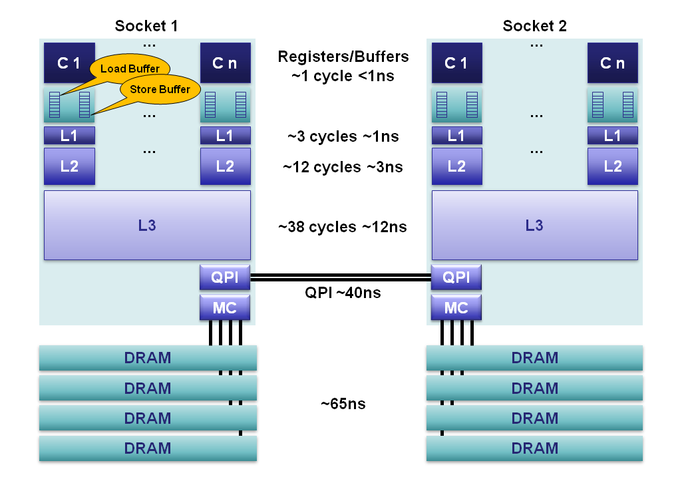
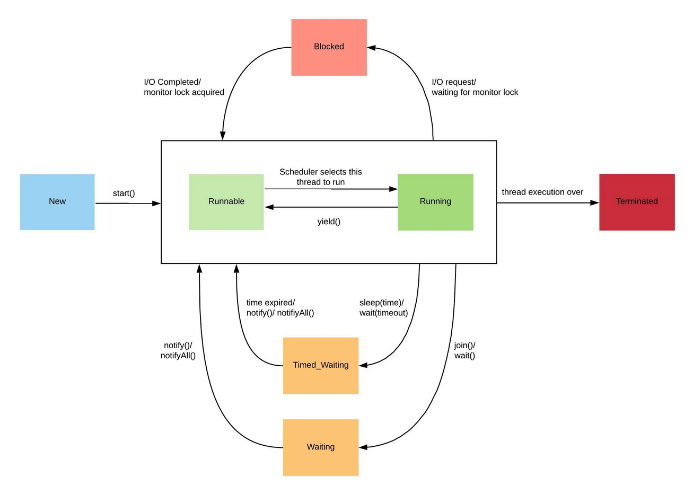
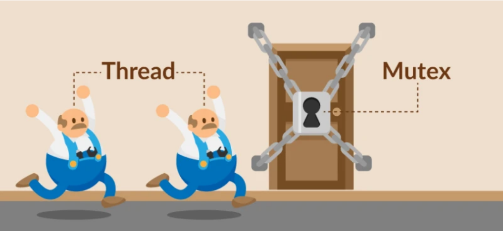
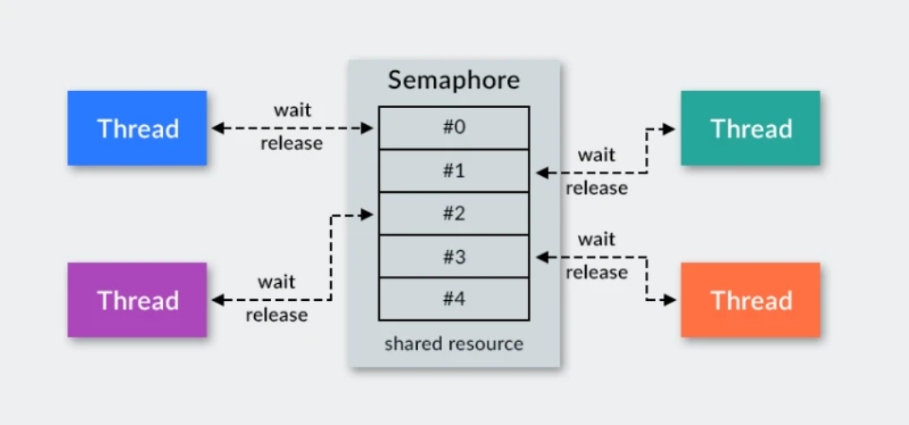
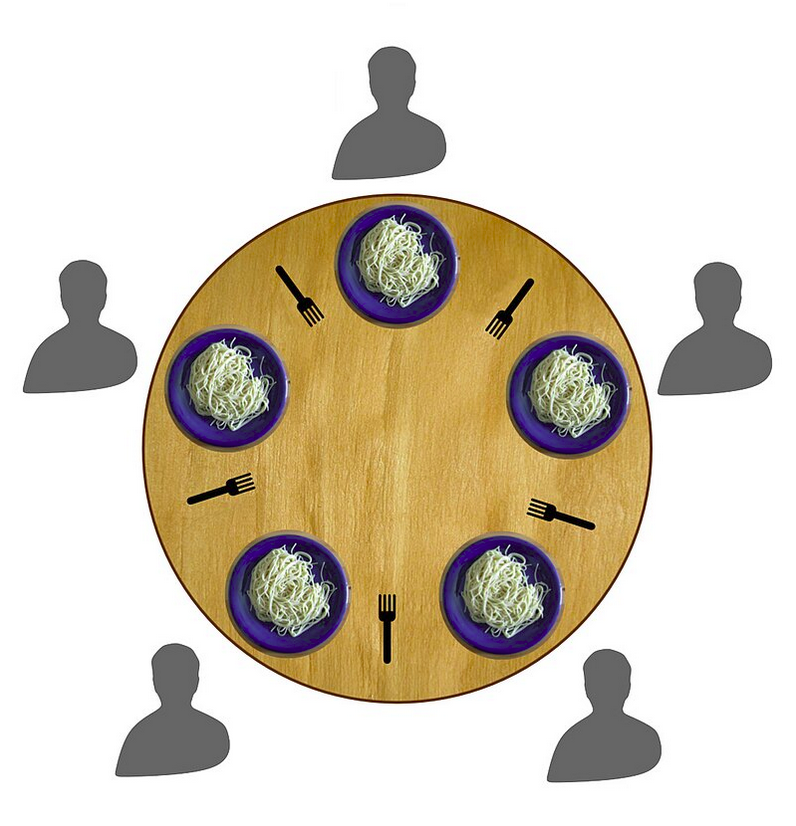

# Лекція 6: Подорож у світ паралельних обчислень

> **Декларація курсу.** Академічна доброчесність та авторство матеріалів — у [DISCLAIMER.md](DISCLAIMER.md).


## ⚡ Експрес-опитування: Активація знань

Ми щойно вивчили принципи SOLID. Давайте поміркуємо над такими життєвими ситуаціями:

1.  Уявіть, що ви запустили `OrderProcessor` з [Лекції 5](05_solid.md) і одночасно намагаєтесь обробити 1000 замовлень в інтернет-магазині. Що відбуватиметься "під капотом"?
2.  Наш фінальний проєкт — комп'ютерна гра. Що станеться, якщо логіка AI (штучного інтелекту) буде складною і "задумається" на 5 секунд під час свого ходу?
3.  Як ви думаєте, скільки "справ" одночасно виконує ваш веб-браузер просто зараз?
4.  У Monobank під час масового збору тисячі людей одночасно натискають кнопку «Задонатити 10 грн». Усі вони змінюють одне поле `long totalDonations` у пам’яті сервера. Чи гарантовано підсумкова сума буде правильною без спеціальних заходів захисту?

<details markdown="1">
<summary>Наші очікування (відповідь)</summary>

1.  Якщо код процесора замовлень виконується в **одному потоці**, він оброблятиме замовлення **строго послідовно** — одне за одним. 1000 замовлень займуть дуже багато часу, і користувачі чекатимуть годинами.
2.  Якщо логіка AI та інтерфейс користувача (UI) працюють в **одному потоці**, гра повністю "зависне" (freeze). Гравець не зможе навіть поворухнути мишкою чи натиснути кнопку виходу, поки AI не завершить розрахунки.
3.  Браузер виконує десятки паралельних завдань одночасно: один потік малює веб-сторінку, другий відтворює відео на YouTube, третій завантажує файл у фоні, четвертий очікує нові сповіщення від сервера. Це і є **багатопотоковість**.
4.  **Ні, сума гарантовано спотвориться!** Без спеціальних засобів виникає стан гонитви (**race condition**), і частина грошей просто зникне з балансу. Як саме це відбувається і як це полагодити — розбираємо на [Практикумі 7](p07_race_condition.md).

</details>

## Вступ

**Мета заняття.** Зрозуміти, як індустрія прискорювала програми на одній машині і чому після стелі гігагерц ставка змістилася на **паралельне виконання** на кількох ядрах. Далі — шар Java **над** потоками ОС: хто реально виконується на ядрі (потік операційної системи), а що дає мова й JVM (`Thread`, `Runnable`, життєвий цикл, `synchronized`, `java.util.concurrent`). Без цього рівня неможливо коректно писати серверний код у хмарі.

### Еволюція продуктивності: Три рівні прискорення

Історія боротьби за швидкість обчислень — це не одна технологія, а послідовна зміна парадигм:

1. **Ера тактової частоти (одне ядро, вищий GHz):**
   Довгі роки прогрес полягав у простому нарощуванні тактової частоти одного процесорного ядра (згадаймо класичні процесори 90-х років на кшталт Intel Pentium з частотами у кілька десятків мегагерц). Більше тактів на секунду означало швидше виконання **одного послідовного потоку інструкцій**.
   У класифікації Флінна (Flynn's taxonomy) це відповідає архітектурі **SISD** (*Single Instruction, Single Data*): одна інструкція опрацьовує один елемент даних за такт.
   Додатковий виграш на тому ж ядрі надав підхід **SIMD** (*Single Instruction, Multiple Data*) — одна інструкція паралельно обробляє цілий вектор або пакет даних (сучасні інструкції SSE, AVX у CPU). Спеціалізоване залізо (наприклад, **GPU**) розвинуло цей підхід далі: конвеєрна обробка потоку графічних даних (часто класифікується як конвеєрний SIMD або підвид MISD).
   Але на початку 2000-х індустрія вперлася у фізичні та термодинамічні обмеження: так звану **"стіну потужності" (Power Wall)**. Подальше підвищення частоти понад 3–5 GHz викликало катастрофічний ріст тепловиділення та нестабільність кремнію. Ера експоненційного росту гігагерц завершилася.

2. **Ера багатоядерності та багатопотоковості (один комп'ютер, багато ядер):**
   Виробники змінили підхід: замість спроб зробити одне ядро вдесятеро швидшим, вони розмістили на одному кристалі **кілька незалежних ядер**.
   За класифікацією Флінна це **MIMD** (*Multiple Instruction, Multiple Data*): кілька процесорних ядер одночасно виконують зовсім різні потоки інструкцій над різними даними.
   У Java це відбилося появою багатопотоковості в межах єдиного процесу: одна віртуальна машина (JVM), спільний простір об'єктів (Heap) та окремі стеки викликів для кожного потоку. Саме на цьому рівні виникають класичні виклики: `Thread`, `Runnable`, `synchronized`, стан гонитви та дедлоки. **Цей рівень — головний фокус нашої лекції.**

3. **Ера розподілених і хмарних систем (багато комп'ютерів, кластери):**
   Коли ресурсів одного навіть 64-ядерного сервера стає замало, навантаження розподіляють між десятками й сотнями окремих серверів: реплікація баз даних, балансувальники навантаження, черги повідомлень (Kafka, RabbitMQ).
   Це масштабний MIMD на рівні датацентру. Розподілені системи не скасовують багатопотоковість — навпаки, на кожному сервері всередині кластера працює JVM із десятками потоків! Цю тему ми детально вивчатимемо у [другому семестрі](02_semester/10_distributed_systems.md).

> **Фокус поточної лекції:** один комп'ютер, один процес JVM, багатопотоковість у спільній пам'яті.
> Одразу після теорії закріплюємо знання на практиці: [Практикум 7: Чому "Банка" Monobank не губить ваші донати?](p07_race_condition.md).

-----

## Навіщо нам усе це на одній машині?

Навіть якщо наш сервіс працює на одному фізичному сервері, перед нами стоять дві ключові інженерні задачі:

### 1. Відгукливість (Responsiveness)
Якщо важка операція (звернення до жорсткого диска, повільний мережевий запит до платіжного шлюзу або складний розрахунок аналітики) виконується в тому самому потоці, який обслуговує користувача, додаток повністю заблокується. Виділення окремого фонового потоку дозволяє інтерфейсу або веб-серверу миттєво відповідати користувачеві, поки обчислення тривають у фоні.

### 2. Ефективна утилізація багатоядерного процесора (Throughput)
Якщо у вашому сервері 16 ядер, але програма однопотокова, 15 ядер будуть простоювати, споживаючи енергію даремно. Проте важливо пам'ятати: **один важкий цикл у єдиному потоці не прискориться від наявності 16 ядер**.

Більше того, операційна система може періодично переносити виконуваний потік з одного ядра на інше (ефект **Hotspot**). Якщо ви відкриєте `htop` або диспетчер завдань, то побачите, що 100% завантаження стрибає між різними ядрами. Кожне таке перемикання скидає кеші L1/L2 для цього потоку — вони стають "холодними", і процесор змушений заново вичитувати дані з повільної пам'яті. Щоб задіяти всі ядра, потрібно розбивати роботу на **паралельні задачі**.

### Анатомія одного HTTP-запиту: Чому потоки простоюють?

Уявімо звичайний бекенд-сервіс (наприклад, на Spring Boot). Зовні здається, що запит клієнта обробляється дуже швидко — скажімо, за **10 мілісекунд (ms)**. Але зазирнімо всередину:

| Фаза обробки | Час (орієнтовно) | Що відбувається "під капотом"? | Стан CPU |
|:---|:---:|:---|:---:|
| 1. Прийом запиту | ~1 ms | Читання байтів із сокета, парсинг HTTP, десеріалізація JSON | CPU активно працює |
| 2. Очікування (I/O) | **~8 ms** | Запит до бази даних PostgreSQL або стороннього REST API | **CPU простоює (потік чекає)** |
| 3. Формування відповіді | ~1 ms | Обробка результату, серіалізація відповіді в JSON, відправка | CPU активно працює |

**Зверніть увагу:** з 10 ms обробки запиту майже **80% часу потік нічого не рахує** — він просто заблокований і чекає відповіді від мережі або бази даних!

### Блокуючий проти неблокуючого стилю

* **Блокуючий стиль (Blocking / Synchronous):**
  Класичний лінійний код, на якому будується більшість додатків (JDBC, JPA, стандартні клієнти):
  ```java
  Order order = repository.findById(id); // Потік тут "засинає", поки база не відповість
  ```
  Потік не витрачає процесорні цикли під час очікування, але його дорогий системний ресурс (стек пам'яті в кілька мегабайтів) залишається зарезервованим і замороженим.
* **Неблокуючий стиль (Non-blocking / Asynchronous / Reactive):**
  Замість очікування потік реєструє функцію зворотного виклику (callback) або повертає `CompletableFuture` / реактивний потік (`Mono`, `Flux`) і одразу звільняється для обробки інших подій. Це дає високу пропускну здатність, але кардинально ускладнює читання коду, трасування помилок та налагодження: дебаг перетворюється на виклик ланцюжків лямбд, класичні стектрейси втрачають контекст, а саме написання та підтримка коду в неблокуючому стилі вимагає **значно, значно вищої кваліфікації від програміста**.

### Проблема наївної моделі «Один клієнт = Один системний потік»

Якщо на кожен вхідний запит створювати новий класичний потік (`new Thread()`), то при 10 000 одночасних клієнтів системі знадобиться створити 10 000 системних потоків.
Кожен потік за замовчуванням потребує близько 1 МБ пам'яті під стек. Лише на підтримку стеків знадобиться 10 ГБ оперативної пам'яті! Планувальник операційної системи витрачатиме більше часу на перемикання контексту (context switching), ніж на корисну роботу, і система впаде з `OutOfMemoryError`.

Саме тому в індустрії використовують:
1. **Пули потоків (Thread Pools / `ExecutorService`):** Обмежують кількість одночасних системних "робітників" (наприклад, 200 потоків), а всі надлишкові завдання вишиковують у чергу ([Практикум 9](p09_executors.md)).
2. **Віртуальні потоки (Virtual Threads / Java 21+):** Оскільки неблокуючий реактивний підхід вимагає значно, значно вищої кваліфікації від інженера, віртуальні потоки стали справжньою революцією — вони дозволяють зберегти звичний, простий і зрозумілий блокуючий стиль написання коду, водночас забезпечуючи можливість створювати мільйони надлегких потоків у пам'яті JVM без перевантаження операційної системи.

-----

## Як працюють сучасні процесори та операційна система?

Щоб писати надійний багатопотоковий код, треба розуміти архітектуру сучасного процесора (CPU).

Сучасний процесор складається з кількох фізичних **ядер (Cores)**. Кожне ядро — це повноцінний автономний обчислювальний юніт. Якщо процесор 8-ядерний, він може фізично одночасно виконувати 8 потоків інструкцій.

Більшість процесорів також підтримують технологію **Hyper-Threading** (або SMT — Simultaneous Multithreading). Фізичне ядро надає операційній системі два **логічні ядра**, розділяючи спільні конвеєри та виконавчі блоки між двома потоками команд.

> [!NOTE]
> **Як Hyper-Threading працює «під капотом» (і чому це не напівтакти):**
> Поширена помилка — вважати, що Hyper-Threading працює подібно до DDR-пам'яті (один потік на висхідному фронті тактового імпульсу, а другий — на спадному). Насправді такти не діляться навпіл:
> 1. **Проблема простою:** Фізичне ядро процесора є суперскалярним — воно має всередині цілий набір паралельних обчислювальних блоків (4–6 цілочисельних ALU, 2–3 блоки Load/Store, векторні FPU-модулі). Один потік через очікування кешу та залежності між інструкціями рідко завантажує більше 2–3 блоків одночасно; решта в кожному такті простоюють.
> 2. **Що продубльовано:** Інженери продублювали на кристалі лише **архітектурний стан (Architectural State)** — набір регістрів (RAX, RBX тощо), вказівник поточної інструкції (Instruction Pointer / PC) та контролер переривань. Це займає лише ~3–5% площі кремнію ядра, але операційна система бачить це як два окремі логічні процесори.
> 3. **Що спільне:** Усі обчислювальні блоки (ALU, FPU) та кеші L1/L2 залишаються **спільними**. Планувальник ядра в **кожному такті** аналізує черги обох потоків: якщо Потік 0 чекає на відповідь від повільної пам'яті (пауза / stall), вільні ALU в цей самий такт виконують інструкції Потоку 1.
> 
> Саме тому Hyper-Threading дає не подвоєння потужності (+100%), як окреме фізичне ядро, а лише **+15–30%** реального приросту (заповнюючи собою «дірки» та паузи під час простоїв).

### Ієрархія кешів пам'яті: Чому RAM — це повільно?

Оперативна пам'ять (RAM) за мірками сучасного процесора є надзвичайно повільною. Звернення до оперативної пам'яті займає сотні тактів процесора (порядку 50–100 наносекунд).
Щоб процесор не простоював в очікуванні даних, на кристалі реалізовано багаторівневу ієрархію надшвидкої кеш-пам'яті:

* **L1 Cache (Кеш першого рівня):** Найшвидший (1–2 наносекунди, кілька тактів) і найменший (зазвичай 32–64 КБ на ядро). Розділений окремо на кеш інструкцій (L1i) та кеш даних (L1d). Індивідуальний для кожного ядра.
* **L2 Cache (Кеш другого рівня):** Трохи більший за об'ємом (512 КБ – 1 МБ), дещо повільніший (3–5 наносекунд). Також переважно виділений під конкретне ядро.
* **L3 Cache (Кеш третього рівня):** Спільний для всіх ядер процесора. Має значний об'єм (від десятків до сотень мегабайтів), доступний усім ядрам за 10–20 наносекунд.



### Потік у Java та потік в операційній системі

Класичний потік у Java (Platform Thread) створюється не на порожньому місці. Віртуальна машина Java (JVM) делегує створення потоку безпосередньо операційній системі (Linux, Windows, macOS). **Один потік Java відповідає одному потоку ядра ОС (1:1 mapping).**

Коли ви викликаєте `thread.start()`, потік не починає виконуватися миттєво: JVM просто реєструє його в системному **планувальнику операційної системи (OS Scheduler)**. Саме планувальник ОС вирішує, яке ядро процесора і на скільки мілісекунд (квант часу) виділити для виконання цього потоку.

### Переваги багатопотоковості
* **Максимальна продуктивність:** Паралельне виконання незалежних задач на всіх доступних ядрах процесора.
* **Відгукливість додатків:** Відокремлення тривалих операцій введення-виведення (I/O) від користувацького інтерфейсу або обробки мережевих подій.
* **Ефективне використання обладнання:** Зменшення часу простою CPU під час очікування зовнішніх ресурсів.

### Виклики та небезпеки
* **Складність розробки та мислення:** Людському мозку важко відстежувати одночасне виконання сотень взаємодіючих операцій.
* **Недетерміновані баги:** Помилки синхронізації залежать від швидкодії заліза, кількості ядер та планувальника ОС. Код може ідеально працювати на комп'ютері розробника і падати у продакшені.
* **Накладні витрати на блокування:** Неправильна синхронізація створює "черги очікування", де ядра процесора марнують час, чекаючи на звільнення замків.
* **Смертельні пастки:** Стан гонитви (Race Condition), взаємні блокування (Deadlocks) та ресурсне голодування (Starvation).

-----

## Що таке потік у Java?

У Java потік (**Thread**) — це найменша одиниця виконання коду всередині процесу JVM.

Усі потоки одного процесу Java мають важливу особливість:
* **Спільна пам'ять (Heap):** Усі об'єкти, масиви та поля екземплярів класів живуть у купі (Heap). Будь-який потік, що має посилання на об'єкт, може прочитати або змінити його поля.
* **Ізольована пам'ять (Thread Stack):** Кожен потік має свій власний, абсолютно приватний стек викликів (Call Stack). Локальні змінні методів та примітиви живуть у стеку і ніколи не можуть бути напряму пошкоджені іншим потоком.

> [!IMPORTANT]
> **Звідси головне правило конкурентності:** Якщо дані локальні всередині методу — вони потокобезпечні за своєю природою. Якщо дані зберігаються у спільних полях класу (в Heap) і кілька потоків одночасно намагаються їх змінити — виникає хаос, якщо не використовувати засоби синхронізації.

-----

## Створення та запуск потоків: `Runnable` vs `Thread`

Історично в мові Java існує два способи створити потік:

1. **Успадкувати клас `Thread`** і перевизначити метод `run()`.
2. **Реалізувати інтерфейс `Runnable`** і передати його екземпляр у конструктор класу `Thread`.

```java
package org.example;

// Спосіб 1: Через наслідування класу Thread
class HelloThread extends Thread {
    @Override
    public void run() {
        System.out.println("Привіт з потоку HelloThread!");
    }
}

// Спосіб 2: Через реалізацію інтерфейсу Runnable (РЕКОМЕНДОВАНИЙ)
class HelloRunnable implements Runnable {
    @Override
    public void run() {
        System.out.println("Привіт з потоку HelloRunnable!");
    }
}

public class Main {
    public static void main(String[] args) {
        // Запуск через наслідування
        HelloThread thread1 = new HelloThread();
        thread1.start();

        // Запуск через Runnable
        HelloRunnable runnableTask = new HelloRunnable();
        Thread thread2 = new Thread(runnableTask);
        thread2.start();
    }
}
```

### Чому підхід через `Runnable` є стандартом індустрії?
* **Java не підтримує множинне наслідування класів.** Якщо ваш клас уже успадкував `Thread`, ви не зможете успадкувати жоден інший бізнес-клас. Реалізація `Runnable` позбавлена цього обмеження (інтерфейсів можна імплементувати скільки завгодно).
* **Розділення відповідальностей (SRP з [Лекції 5](05_solid.md)):** Зміст задачі («що саме робити» — `Runnable`) чітко відокремлюється від механізму її запуску («як і де виконувати» — `Thread`). Завдяки цьому бізнес-код не прив'язується жорстко до системного потоку: те саме завдання можна запустити в окремому потоці, передати в пул робітників або виконати синхронно під час тестів.
* **Сумісність із пулами потоків:** Класи `ExecutorService` приймають саме завдання `Runnable`, повторно використовуючи існуючі системні потоки замість створення нових.

### Сучасний синтаксис: Лямбда-вирази для `Runnable`

Оскільки `Runnable` — це функціональний інтерфейс (має лише один абстрактний метод `void run()`), його можна лаконічно записати за допомогою лямбда-виразу `() -> { ... }`:

```java
// Короткий і зручний запис
Runnable task = () -> System.out.println("Виконується завдання в новому потоці через лямбду!");
new Thread(task).start();
```

> [!CAUTION]
> **Головна помилка початківця: `run()` vs `start()`**
> Завжди запускайте потік методом **`start()`**!
> * `thread.start()` звертається до JVM/ОС, створює **новий системний потік** і асинхронно виконує в ньому код методу `run()`.
> * `thread.run()` — це просто звичайний виклик методу в **поточному** потоці (у потоці `main`). Жодного нового потоку не створюється, і жодного паралелізму не відбувається!

-----

## Життєвий цикл потоку (Thread Lifecycle)

Потік у Java не просто працює або не працює. Він проходить чітко визначені стани життєвого циклу (перелічені в енумі `Thread.State`):

* **`NEW`:** Потік створено (`new Thread()`), але метод `start()` ще не викликали.
* **`RUNNABLE`:** Потік готовий до роботи або вже виконується на ядрі CPU. Планувальник ОС виділяє йому кванти часу.
* **`BLOCKED`:** Потік призупинено, оскільки він намагається увійти в синхронізований блок (`synchronized`), але монітор об'єкта зайнятий іншим потоком.
* **`WAITING`:** Потік безстроково чекає сигналу від іншого потоку (виклики `wait()` без таймауту або `join()`).
* **`TIMED_WAITING`:** Потік чекає вказаний проміжок часу (виклики `sleep(millis)`, `wait(timeout)` або `join(timeout)`).
* **`TERMINATED`:** Потік повністю завершив виконання методу `run()` і припинив своє існування.



### Як потік рухається між станами?

1. При виклику `start()` потік переходить зі стану **`NEW`** у **`RUNNABLE`**.
2. У стані `RUNNABLE` планувальник операційної системи чергує готовність до виконання (`READY`) та безпосередній рахунок на ядрі (`RUNNING`).
3. Виклик `Thread.sleep(1000)` або `thread.join(1000)` переводить потік у **`TIMED_WAITING`**. Коли час спливає, він повертається в `RUNNABLE`.
4. Спроба викликати метод із `synchronized`, коли там уже працює інший потік, переводить потік у **`BLOCKED`**. Щойно замок звільняється, потік повертається в `RUNNABLE`.
5. Метод `thread.join()` без параметрів змушує поточний потік перейти у **`WAITING`** і чекати завершення цільового потоку.
6. Коли потік добігає кінця методу `run()`, він стає **`TERMINATED`**.

> [!TIP]
> **Як побачити стани наживо:** Якщо ваш сервер завис або поводиться дивно, виконайте в терміналі команду `jstack <PID_процесу>` (де PID — ідентифікатор процесу Java). Ви отримаєте миттєвий текстовий зліпок (Thread Dump) усіх потоків у JVM з їхніми поточними станами (`BLOCKED`, `WAITING`, `RUNNABLE`) та стеками викликів!

-----

## Проблеми паралелізму: Дві принципово різні проблеми

Коли декілька потоків одночасно звертаються до спільної пам'яті, виникають дві абсолютно різні проблеми, які початківці часто плутають:

### 1. Проблема атомарності: Стан гонитви (Race Condition)
Виникає, коли складена операція типу **read-modify-write** (прочитати → змінити → записати) виконується одночасно кількома потоками.

Класичний приклад — звичайний лічильник `count++`. На рівні байткоду це три окремі команди:
1. `GETFIELD`: прочитати значення з пам'яті в стек;
2. `ICONST_1` + `IADD`: додати 1;
3. `PUTFIELD`: записати нове значення назад у пам'ять.

Якщо два потоки перетинаються між кроками 1 і 3, вони обидва прочитають початкове число 5, обидва порахують 6 і обидва запишуть 6. Замість 7 ми отримали 6 — один інкремент безслідно зник! Наскрізний фінансовий приклад із симулятором банки детально розібрано на [Практикумі 7: Чому "Банка" Monobank не губить ваші донати?](p07_race_condition.md).

### 2. Проблема видимості (Memory Visibility / Stale Reads)
Виникає через кеші процесора та оптимізації компілятора. Одне ядро CPU може змінити значення змінної у своєму локальному L1/L2 кеші, але інше ядро процесора читатиме старе значення зі свого локального кешу і ніколи не дізнається про оновлення!

| Критерій | Стан гонитви (Race Condition) | Проблема видимості (Stale Reads) |
|:---|:---|:---|
| **Типовий приклад** | `count++`, `balance += amount` | `stop = true`, прапорці завершення циклу |
| **Що пішло не так?** | Потоки вклинилися всередину складеної операції читання-запису | Потік читає застарілу копію зі свого локального кешу CPU |
| **Що необхідно?** | Атомарність та взаємне виключення | Гарантія синхронізації кешів (*happens-before*) |
| **Інструменти вирішення** | `synchronized`, `ReentrantLock`, `AtomicInteger` | `volatile`, а також `synchronized` / atomic |

### Інші критичні загрози: Deadlock та Starvation
* **Deadlock (Взаємне блокування):** Ситуація мертвого клінчу, коли Потік 1 утримує Ресурс А і чекає на Ресурс Б, а Потік 2 утримує Ресурс Б і чекає на Ресурс А. Жоден потік не може рухатися далі, програма назавжди зависає.
* **Starvation (Ресурсне голодування):** Ситуація, коли певний потік не може отримати доступ до необхідного ресурсу (процесорного часу або замка), оскільки інші потоки з вищим пріоритетом постійно його витісняють.

-----

## Інструменти синхронізації та захисту даних

### Mutex (М'ютекс)

**М'ютекс (або замок)** — це фундаментальний примітив синхронізації. Його назва походить від англійського **MUTual EXclusion (взаємне виключення)**.

> **Життєва аналогія:** М'ютекс працює точно як кабінка туалету. Коли людина заходить у кабінку, вона замикає двері зсередини на засув (захоплює м'ютекс). Будь-хто інший, хто підійде до кабінки, бачить червоний засув і змушений стояти у черзі. Коли людина виходить, двері відчиняються (м'ютекс звільняється), і наступний відвідувач із черги може зайти.



Особливості м'ютекса:
* Має рівно два стани: "заблоковано" (*locked*) та "вільно" (*unlocked*).
* У Java кожен об'єкт має свій вбудований внутрішній м'ютекс (Intrinsic Lock).

### Monitor (Монітор)

У Java м'ютекси представлені концепцією **монітора**. Монітор — це надбудова над м'ютексом, яка поєднує:
1. Взаємне виключення (лише один потік усередині захищеної зони).
2. Механізм координації та сповіщень через методи `wait()`, `notify()` та `notifyAll()`.

Найпростіший спосіб задіяти монітор об'єкта в Java — це ключове слово **`synchronized`**.

-----

### Синтаксис `synchronized` у деталях

Ключове слово `synchronized` завжди прив'язане до конкретного **об'єкта-носія замка**. Існує чотири способи його використання:

```java
public class SyncExamples {
    private static int staticCount = 0;
    private int instanceCount = 0;

    // Спеціальний виділений об'єкт для блокування
    private final Object dedicatedLock = new Object();

    // 1. Метод екземпляра: монітором автоматично виступає поточний об'єкт (this)
    public synchronized void incrementInstance() {
        instanceCount++;
    }

    // 2. Статичний метод: монітором виступає об'єкт класу (SyncExamples.class)
    public static synchronized void incrementStatic() {
        staticCount++;
    }

    // 3. Блок на окремому об'єкті-замку: захищаємо лише критичну секцію
    public void incrementWithDedicatedLock() {
        // Код до блокування виконується вільно і паралельно
        synchronized (dedicatedLock) {
            instanceCount++;
        }
        // Код після блокування
    }

    // 4. Синхронізований блок на об'єкті this:
    // Повністю еквівалентний п. 1, але блокує не весь метод, а лише фрагмент коду
    public void incrementFragment() {
        synchronized (this) {
            instanceCount++;
        }
    }
}
```

> [!NOTE]
> Примітивні типи (`int`, `long`, `boolean`) не є об'єктами, тому їх **не можна** використовувати як монітор: конструкція `synchronized (instanceCount)` викличе помилку компіляції!

-----

### `ReentrantLock` (Явний замок)

У пакеті `java.util.concurrent.locks` є клас `ReentrantLock` — це явний програмний м'ютекс, який надає набагато більшу гнучкість, ніж слово `synchronized`.

```java
import java.util.concurrent.locks.ReentrantLock;
import java.util.concurrent.TimeUnit;

class ReentrantCounter {
    private int count = 0;
    private final ReentrantLock lock = new ReentrantLock();

    // 1. Класичне блокуюче захоплення (чекає в черзі, доки замок звільниться)
    public void increment() {
        lock.lock(); // Захоплюємо замок (потік блокується, якщо зайнято)
        try {
            count++; // Критична секція
        } finally {
            lock.unlock(); // ОБОВ'ЯЗКОВО звільняємо замок у finally!
        }
    }

    // 2. Неблокуюча спроба через tryLock(): якщо зайнято — не чекаємо в черзі
    public boolean tryIncrement() {
        // tryLock() повертає true, якщо замок вільний і його вдалося захопити
        if (lock.tryLock()) {
            try {
                count++;
                return true;
            } finally {
                lock.unlock(); // Звільняємо лише якщо успішно захопили!
            }
        }
        // Замок зайнятий іншим потоком — потік не блокується, а виконує іншу логіку
        System.out.println("Замок зайнятий! Потік не чекає, а займається іншою справою.");
        return false;
    }

    // 3. Спроба з таймаутом: чекаємо звільнення замка не довше зазначеного часу
    public boolean tryIncrementWithTimeout() throws InterruptedException {
        if (lock.tryLock(1, TimeUnit.SECONDS)) { // Чекаємо максимум 1 секунду
            try {
                count++;
                return true;
            } finally {
                lock.unlock();
            }
        }
        System.out.println("Час очікування вичерпано! Замок так і не звільнився.");
        return false;
    }

    public int getCount() {
        return count;
    }
}
```

**Чому `ReentrantLock` потужніший за `synchronized`?**
* **Метод `tryLock()`:** Дозволяє спробувати взяти замок без очікування ("якщо замок вільний — я виконаю операцію, якщо зайнятий — я не засинатиму в `BLOCKED`, а піду робити іншу корисну роботу").
* **Таймаути (`tryLock(time, unit)`):** Дозволяє почекати звільнення замка не довше зазначеного проміжку часу (`tryLock(1, TimeUnit.SECONDS)`), що дозволяє уникнути безстрокового зависання.
* **Справедливість (Fairness):** Конструктор `new ReentrantLock(true)` гарантує, що потік, який чекає довше за всіх, першим отримає замок (FIFO черга), що захищає від ресурсного голодування (Starvation).
* **Головні правила безпеки:**
  * Завжди звільняйте замок через `lock.unlock()` у блоці `finally`! Якщо забути `unlock()`, замок назавжди зависне і програма перейде в стан дедлоку.
  * При використанні `tryLock()` виклик `unlock()` обов'язково має бути **всередині блоку `if (lock.tryLock())`**: якщо викликати `unlock()`, коли замок не було захоплено, Java викине виняток `IllegalMonitorStateException`.

-----

### `AtomicInteger` та безблокувальні операції (CAS)

Для простих операцій (лічильники, індекси, баланси) використання блокувань `synchronized` або `Lock` є занадто дорогим: потоки переходять у стан `BLOCKED`, викликаючи перемикання контексту операційною системою.

Пакет `java.util.concurrent.atomic` (`AtomicInteger`, `AtomicLong`, `AtomicBoolean`, `AtomicReference`) пропонує **безблокувальний (lock-free)** підхід, побудований на апаратних інструкціях процесора.

```java
import java.util.concurrent.atomic.AtomicInteger;

class AtomicCounter {
    // Створюємо атомарну змінну
    private final AtomicInteger count = new AtomicInteger(0);

    public void increment() {
        // Атомарна операція інкременту без жодного блокування!
        count.incrementAndGet();
    }

    public int getCount() {
        return count.get();
    }
}
```

#### Як це працює "під капотом"? Compare-And-Swap (CAS)

Сучасні процесори мають спеціальну атомарну машинну команду — **CAS (Compare-And-Swap)**.
Суть інструкції CAS:
> *"Подивись у комірку пам'яті за цією адресою. Якщо там зараз лежить значення `expected`, запиши туди `newValue` і поверни `true`. Якщо ж хтось інший уже встиг його змінити — нічого не записуй і поверни `false`."*

Ця операція виконується на рівні кремнію як **одна неподільна дія**.

Спрощена логіка методу `incrementAndGet()` виглядає як оптимістичний цикл (Retry Loop):

```text
loop:
    current = read count from memory
    next = current + 1
    if CAS(count, expected: current, update: next) == SUCCESS:
        return next
    else:
        // Хтось нас випередив! Пробуємо знову з новим значенням
        goto loop
```

#### Покроковий приклад роботи двох потоків з CAS:
Початкове значення `count = 5`. Потік А і Потік Б одночасно викликають `incrementAndGet()`:

| Крок | Потік А | Потік Б | Спільний `count` у пам'яті |
|:---:|---|---|:---:|
| 1 | Читає 5. Хоче записати 6. | Читає 5. Хоче записати 6. | 5 |
| 2 | Викликає `CAS(5 -> 6)`: **УСПІХ!** | *Трохи запізнився...* | **6** |
| 3 | Повертає 6 і йде далі. | Викликає `CAS(5 -> 6)`: **ПРОВАЛ!** (Там уже 6, а не 5) | 6 |
| 4 | | Читає актуальне 6. Хоче записати 7. | 6 |
| 5 | | Викликає `CAS(6 -> 7)`: **УСПІХ!** | **7** |

**Результат:** Жоден потік не блокувався і не засинав. Обидва інкременти успішно враховано, підсумок — **7**.

-----

### Проблема видимості та ключове слово `volatile`

Уявіть класичний сценарій фонового потоку-працівника:

```java
class Worker implements Runnable {
    private boolean stopRequested = false; // Звичайне поле

    @Override
    public void run() {
        while (!stopRequested) {
            // Працюємо...
        }
        System.out.println("Worker успішно зупинився!");
    }

    public void stop() {
        stopRequested = true;
    }
}
```

Якщо головний потік `main` викличе `worker.stop()`, потік-працівник може **ніколи не вийти з циклу і зависнути назавжди!**
Чому?
1. Ядро CPU, на якому працює `run()`, закешувало значення `stopRequested = false` у своєму локальному L1-кеші.
2. JIT-компілятор JVM бачить, що всередині циклу змінна `stopRequested` не змінюється, і оптимізує його до `while (true)`.

#### Що робить модифікатор `volatile`?

```java
private volatile boolean stopRequested = false;
```

Ключове слово **`volatile`** вказує JVM та компілятору:
1. Заборонено кешувати цю змінну в регістрах чи локальних кешах ядра так, ніби інших потоків не існує.
2. Будь-який запис у `volatile`-змінну негайно скидається в спільну пам'ять і стає видимим усім іншим ядрам.
3. Встановлюється відношення **happens-before**: усі дії, виконані потоком до запису у `volatile`, гарантовано видно іншим потокам після його читання.

> [!WARNING]
> **Чи захищає `volatile` операцію `count++`?**
> **НІ!** `volatile` гарантує лише видимість поодиноких операцій читання або запису. Він **не робить складену операцію read-modify-write атомарною**! Якщо оголосити `volatile int count = 0` і викликати `count++` з двох потоків, стан гонитви все одно виникне.

#### Зведена порівняльна таблиця механізмів:

| Механізм | Видимість між потоками | Атомарність `count++` | Блокування потоків (BLOCKED) |
|:---|:---:|:---:|:---:|
| **Звичайне поле** | ❌ Не гарантується | ❌ Ні | ❌ Ні |
| **`volatile`** |  Гарантується | ❌ Ні | ❌ Ні |
| **`synchronized` / `Lock`** |  Гарантується |  Так (на весь блок) |  Так (дорогі черги) |
| **`AtomicInteger`** |  Гарантується |  Так (на рівні CPU) | ❌ Ні (швидкий CAS-цикл) |

-----

### Semaphore (Семафор)

**Семафор** — це лічильник дозволів (*permits*), який регулює одночасний доступ кількох потоків до спільного ресурсу.

> **Аналогія:** Якщо м'ютекс — це туалет з 1 кабінкою, то семафор `Semaphore(3)` — це громадська вбиральня з 3 кабінками. Перші 3 відвідувачі заходять одразу. Четвертий стоїть і чекає, поки будь-хто з перших трьох не звільнить кабінку.



Основні методи:
* `semaphore.acquire()`: Потік запитує дозвіл. Якщо лічильник > 0, потік забирає дозвіл і продовжує роботу. Якщо 0 — потік блокується і чекає.
* `semaphore.release()`: Потік повертає дозвіл назад у семафор, збільшуючи лічильник і будячи чергового очікуючого.
* Семафор з одним дозволом `new Semaphore(1)` є еквівалентом м'ютекса (його називають бінарним семафором).

-----

### Проблема філософів, що обідають (Dining Philosophers)

Це класична задача, запропонована Едсгером Дейкстрою, яка наочно демонструє небезпеку взаємних блокувань (Deadlock) та ресурсного голодування (Starvation).



**Умови:**
За круглим столом сидять 5 філософів. Між кожною парою сусідніх філософів лежить одна виделка (усього 5 виделок). Щоб поїсти спагеті, філософу обов'язково потрібні **дві виделки** (і ліва, і права).

**Як виникає Deadlock:**
Якщо всі 5 філософів одночасно візьмуть свою **ліву виделку**, ліва виделка кожного виявиться зайнятою. Тепер кожен філософ чекає, поки звільниться його **права виделка**. Оскільки ніхто не відпускає свою виделку, поки не поїсть, система назавжди входить у клінч — усі філософи помирають від голоду.

**Вирішення за допомогою `Semaphore`:**
Один із найпростіших способів запобігти мертвому клінчу — обмежити кількість філософів, які одночасно можуть сісти за стіл, до 2 (або до $N-1 = 4$):

```java
import java.util.concurrent.Semaphore;

class Philosopher extends Thread {
    private final Semaphore tableLimit;
    private final String philosopherName;

    public Philosopher(Semaphore tableLimit, String name) {
        this.tableLimit = tableLimit;
        this.philosopherName = name;
    }

    @Override
    public void run() {
        try {
            // Запитуємо дозвіл сісти за стіл
            tableLimit.acquire();
            System.out.println(philosopherName + " сів за стіл та обідає...");
            Thread.sleep(300); // Їсть
            System.out.println(philosopherName + " поїв і звільняє стіл!");
            tableLimit.release(); // Звільняє місце
        } catch (InterruptedException e) {
            Thread.currentThread().interrupt();
        }
    }
}

public class PhilosopherDining {
    public static void main(String[] args) {
        // За стіл пускаємо одночасно максимум 2 філософів
        Semaphore tableLimit = new Semaphore(2);

        new Philosopher(tableLimit, "Сократ").start();
        new Philosopher(tableLimit, "Платон").start();
        new Philosopher(tableLimit, "Арістотель").start();
        new Philosopher(tableLimit, "Фалес").start();
        new Philosopher(tableLimit, "Піфагор").start();
    }
}
```

-----

## Методи координації та управління потоками

* **`Thread.sleep(millis)`:** Призупиняє виконання поточного потоку на зазначений час.
  > [!IMPORTANT]
  > Метод `sleep()` **НЕ звільняє** захоплені монітори чи замки! Якщо ви викликали `sleep()` всередині блоку `synchronized`, усі інші потоки продовжуватимуть чекати біля замка.
* **`thread.join()`:** Змушує потік, що його викликав (наприклад, `main`), призупинитися і чекати, доки потік `thread` повністю не завершить свою роботу.
* **`object.wait()`:** Викликається **виключно всередині `synchronized` блоку** на моніторі `object`. Потік тимчасово **відпускає замок** і засинає в очікуванні сигналу.
* **`object.notify()` / `object.notifyAll()`:** "Будить" один (або всі) потоки, які раніше заснули на цьому моніторі через `wait()`.

### Приклад взаємодії через `wait()` та `notify()`

```java
package org.example;

public class WaitNotifyExample {
    public static void main(String[] args) throws InterruptedException {
        Object lock = new Object();

        Thread waiter = new Thread(() -> {
            synchronized (lock) {
                try {
                    System.out.println("Потік-очікувач: Чекаю на сигнал...");
                    lock.wait(); // Відпускає замок lock і засинає
                    System.out.println("Потік-очікувач: Сигнал отримано! Продовжую роботу.");
                } catch (InterruptedException e) {
                    Thread.currentThread().interrupt();
                }
            }
        });

        Thread notifier = new Thread(() -> {
            synchronized (lock) {
                System.out.println("Потік-сповіщувач: Відправляю сигнал...");
                lock.notify(); // Будить сплячий потік
                System.out.println("Потік-сповіщувач: Сигнал надіслано.");
            }
        });

        waiter.start();
        Thread.sleep(500); // Даємо waiter-у час увійти у wait()
        notifier.start();
    }
}
```

-----

## Потоки-демони (Daemon Threads)

Потоки в Java поділяються на два типи:
1. **Користувацькі потоки (User Threads):** Звичайні робочі потоки. Поки в JVM працює хоча б один такий потік, програма не завершиться.
2. **Потоки-демони (Daemon Threads):** Фоновий допоміжний обслуговуючий персонал. Вони не мають самостійної цінності. Щойно всі користувацькі потоки завершують свою роботу, **JVM негайно примусово знищує всі потоки-демони** і завершує процес програми.

Класичний приклад демона — збирач сміття (Garbage Collector).

Зробити потік демоном можна до його запуску:
```java
Thread daemonThread = new Thread(() -> {
    while (true) {
        // Фонова перевірка сповіщень
    }
});
daemonThread.setDaemon(true); // Встановлюємо статус демона
daemonThread.start();
```

-----

## Сучасна епоха: Віртуальні потоки (Java 21+ / Project Loom)

Упродовж понад 25 років розробники в Java жили з моделлю **Platform Threads** (платформні потоки), де кожен `new Thread()` був безпосередньо прив'язаний до потоку ядра операційної системи (1:1).

Створення системного потоку — це дорога операція:
* Кожен потік потребує окремий стек пам'яті (за замовчуванням ~1 МБ).
* Кількість системних потоків на машині жорстко обмежена ресурсами ядра ОС (тисячі потоків — це вже межа стабільності).
* Перемикання контексту між тисячами потоків перевантажує планувальник ядра ОС.

Революція настала з виходом **Java 21 LTS (JEP 444)**, де стандартом стали **віртуальні потоки (Virtual Threads)**:

### Платформні проти віртуальних потоків

| Критерій | Платформний потік (Platform Thread) | Віртуальний потік (Virtual Thread) |
|:---|:---|:---|
| **Ким керується?** | Операційною системою (OS Kernel) | Безпосередньо Віртуальною машиною (JVM) |
| **Витрати пам'яті** | Близько **1–2 МБ** на потік | Лише **кілька кілобайтів** на потік |
| **Реальна кількість** | Кілька сотень або тисяч | **Мільйони одночасно** в одній JVM |
| **Цільове призначення** | CPU-інтенсивні задачі (кодування відео, математика) | **I/O-інтенсивні задачі** (БД, мережа, REST-клієнти) |
| **Стиль коду** | Пули потоків, async/reactive | **Простий синхронний блокуючий код** |

### Потоки-носії (Carrier Threads)

Віртуальні потоки не існують самі по собі — вони виконуються на невеликій кількості звичайних платформних потоків-**носіїв (Carrier Threads)**. За замовчуванням кількість носіїв приблизно дорівнює кількості ядер вашого процесора.

Схема взаємодії ($M \ll N$):
```text
[ Віртуальний потік 1 ] [ Віртуальний потік 2 ] ... [ Віртуальний потік N ]  (N = 100 000)
            \                     |                     /
             \                    |                    /
              [ Carrier OS потік 1 ] ... [ Carrier OS потік M ]               (M = 8–16 ядер)
```

**Магія unmount (демонтажу):**
Коли віртуальний потік доходить до блокуючої операції (наприклад, `socket.read()`, звернення до бази даних або `Thread.sleep()`), JVM фіксує це, **демонтує (unmount)** віртуальний потік із потоку-носія і зберігає його легкий стек у купі (Heap).
Потік-носій миттєво бере на виконання інший готовий віртуальний потік! Коли відповідь від бази даних надходить, JVM знову монтує перший віртуальний потік на будь-який вільний потік-носій.

### Проблема закріплення (Pinning)

Віртуальний потік не може знятися з носія і "приклеюється" до нього (стан **Pinning**), якщо:
1. Потік виконує чисті тривалі обчислення на процесорі (CPU-bound цикл без жодних викликів введення-виведення).
2. Потік увійшов у класичний блок `synchronized` або викликає нативний код (JNI).

Якщо віртуальний потік "приклеївся", він блокує під собою платформного носія, і інші віртуальні потоки не можуть виконуватися. Для захисту критичних секцій у коді з віртуальними потоками замість `synchronized` рекомендують використовувати `ReentrantLock`.

### Як створити віртуальний потік у Java 21+?

```java
// Варіант 1: Запуск окремого віртуального потоку
Thread vThread = Thread.ofVirtual()
    .name("order-worker-", 1)
    .start(() -> {
        System.out.println("Працює віртуальний потік: " + Thread.currentThread());
    });

// Варіант 2: Виконавець завдань для серверів (одне завдання = один віртуальний потік)
try (var executor = java.util.concurrent.Executors.newVirtualThreadPerTaskExecutor()) {
    for (int i = 0; i < 100_000; i++) {
        final int taskId = i;
        executor.submit(() -> {
            // Звичайний блокуючий виклик I/O
            Thread.sleep(1000);
            return "Task " + taskId + " завершено";
        });
    }
} // Тут try-with-resources автоматично дочекається завершення всіх 100 000 задач!
```

-----

## Екзаменаційний пул (Exam Questions)

**Питання 1: Чому прямий виклик методу `run()` не є еквівалентом виклику методу `start()`?**

<details markdown="1">
<summary>Еталонна відповідь</summary>

Метод `start()` звертається до JVM та операційної системи, виділяє новий системний потік із власним стеком пам'яті, реєструє його в планувальнику ОС і асинхронно запускає в ньому метод `run()`.
Прямий виклик `run()` — це звичайний синхронний виклик методу класу в поточному потоці. Жодного нового потоку не створюється, і паралельного виконання не відбувається.

</details>

**Питання 2: Що таке Deadlock (взаємне блокування) та які наслідки воно має?**

<details markdown="1">
<summary>Еталонна відповідь</summary>

Deadlock — це ситуація мертвого клінчу, коли два або більше потоків циклічно очікують на ресурси (замки/монітори), які взаємно утримуються один одним (Потік А тримає Ресурс 1 і чекає на Ресурс 2, а Потік Б тримає Ресурс 2 і чекає на Ресурс 1).
Потоки назавжди переходять у заблокований стан (`BLOCKED`), програма зависає, ресурси ніколи не звільняються без примусового перезапуску процесу.

</details>

**Питання 3: У чому полягає різниця між ключовим словом `synchronized` та класом `ReentrantLock`?**

<details markdown="1">
<summary>Еталонна відповідь</summary>

* `synchronized` — це вбудований синтаксичний механізм мови Java, який автоматично захоплює та надійно звільняє монітор об'єкта при вході/виході з блоку або методу. Він простий і безпечний від забутих звільнень, але блокує потік безстроково.
* `ReentrantLock` — це явний програмний клас із пакету `java.util.concurrent.locks`. Він вимагає обов'язкового ручного виклику `unlock()` у блоці `finally`, але надає розширені можливості: неблокуючу спробу захоплення (`tryLock()`), таймаути очікування, перевірку черги та режим справедливості (fairness).

</details>

**Питання 4: Які існують основні стани життєвого циклу потоку в Java (Thread Lifecycle)?**

<details markdown="1">
<summary>Еталонна відповідь</summary>

Згідно з переліком `Thread.State`:
1. `NEW` — об'єкт потоку створено, `start()` ще не викликано.
2. `RUNNABLE` — потік виконується на процесорі або готовий до виконання в черзі планувальника ОС.
3. `BLOCKED` — потік очікує на звільнення монітора для входу в `synchronized` блок.
4. `WAITING` — потік безстроково чекає сигналу від іншого потоку (`wait()`, `join()`).
5. `TIMED_WAITING` — потік чекає вказаний час (`sleep()`, `wait(timeout)`, `join(timeout)`).
6. `TERMINATED` — потік повністю завершив виконання методу `run()`.

</details>

**Питання 5: Чому помилки типу "стан гонитви" (race condition) важко виявити модульними тестами?**

<details markdown="1">
<summary>Еталонна відповідь</summary>

Стан гонитви залежить від недетермінованого перемикання квантів часу процесора системним планувальником операційної системи. На локальному комп'ютері розробника під низьким навантаженням тест може пройти успішно 1000 разів, оскільки операції випадково не перетнулися. Проте у продакшені на іншому процесорі під піковим навантаженням помилка гарантовано проявиться.

</details>

**Питання 6: Чи достатньо позначити змінну модифікатором `volatile`, щоб операція `count++` стала потокобезпечною?**

<details markdown="1">
<summary>Еталонна відповідь</summary>

Ні, категорично недостатньо! Модифікатор `volatile` гарантує лише видимість змінної між ядрами та забороняє кешування, але він не забезпечує атомарність складених операцій. Операція `count++` складається з трьох дій: читання, додавання одиниці та запис. Між цими діями інший потік може вклинитися і перезаписати результат. Для атомарного інкременту потрібен `synchronized`, `ReentrantLock` або `AtomicInteger`.

</details>

**Питання 7: Як працює механізм Compare-And-Swap (CAS) під капотом `AtomicInteger`?**

<details markdown="1">
<summary>Еталонна відповідь</summary>

CAS — це апаратна атомарна інструкція процесора. Вона порівнює поточне значення в пам'яті з очікуваним (`expected`): якщо вони рівні, записується нове значення (`newValue`) і повертається `true`. Якщо значення вже змінене іншим потоком, запис не відбувається і повертається `false`. Клас `AtomicInteger` виконує оновлення в оптимістичному циклі (Retry Loop): якщо спроба CAS зазнала невдачі через конкуренцію, потік не засинає в черзі монітора, а миттєво повторює операцію з новим прочитаним значенням.

</details>

**Питання 8: Чим віртуальні потоки (Virtual Threads) відрізняються від платформних і для яких завдань вони призначені?**

<details markdown="1">
<summary>Еталонна відповідь</summary>

Платформні потоки мають відображення 1:1 на системні потоки ядра ОС, вимагають близько 1 МБ стеку пам'яті кожен і обмежені кількома тисячами.
Віртуальні потоки (Java 21+) керуються безпосередньо JVM, займають лише кілька кілобайтів пам'яті в купі і можуть створюватися мільйонами. Під час блокуючого I/O (мережа, база даних, sleep) JVM автоматично знімає (unmount) віртуальний потік з платформного потоку-носія (Carrier Thread), дозволяючи іншим задачам виконуватися. Вони призначені для масштабування високонавантажених серверних додатків із переважанням операцій блокуючого введення-виведення (I/O-bound).

</details>

---

**[⬅️ Лекція 5: Принципи SOLID](05_solid.md)** | **[Лекція 7: Пошук та усунення несправностей (Troubleshooting) ➡️](07_troubleshooting.md)**

**[Практикум 7: Банка Monobank](p07_race_condition.md)** · **[Повернутися до головного меню курсу](index.md)**
