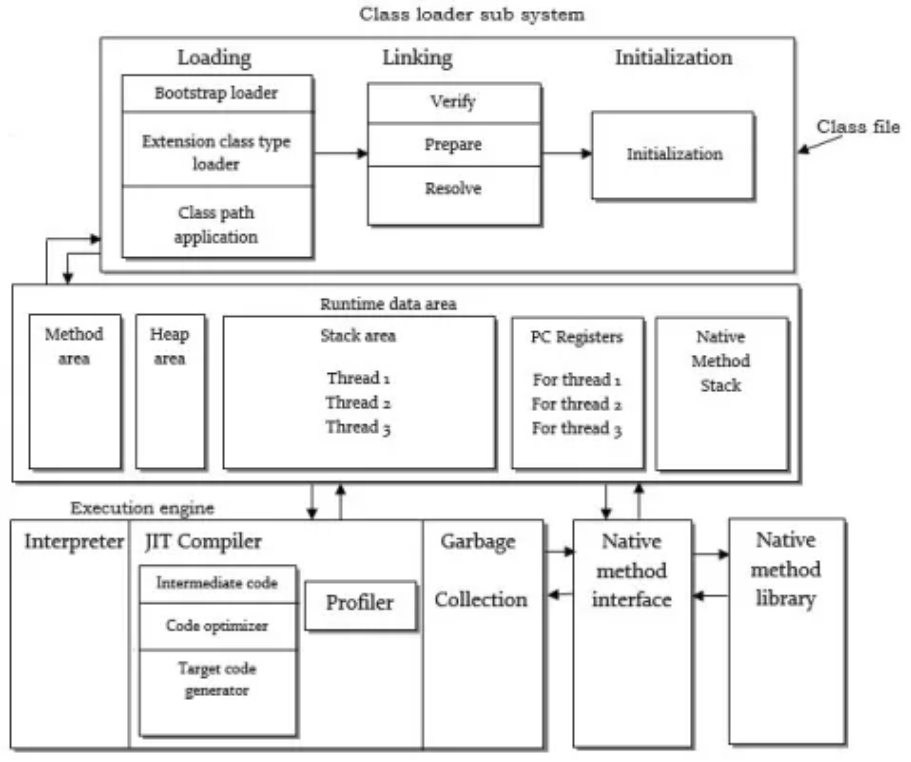
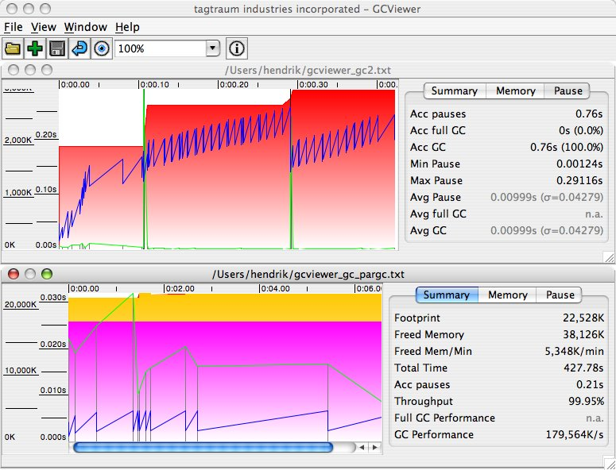
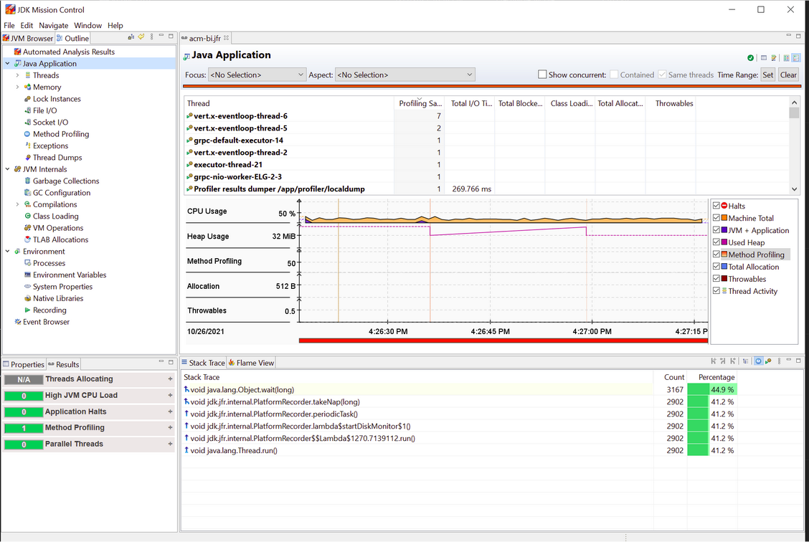
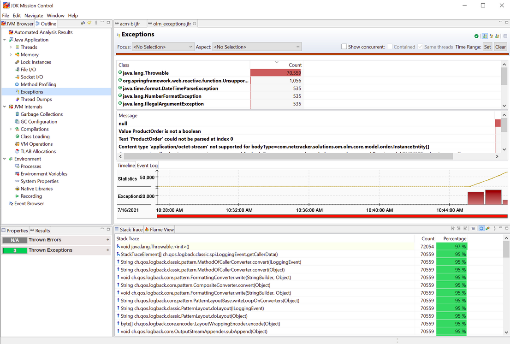
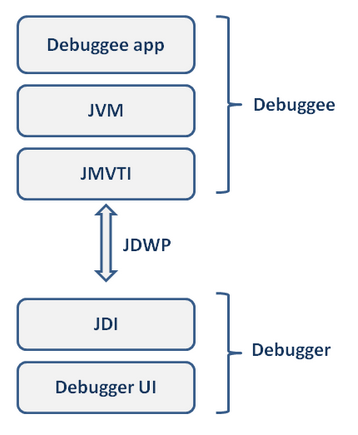
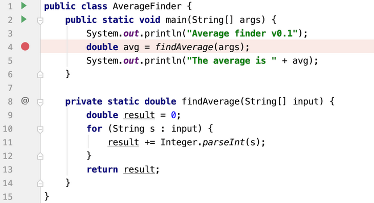
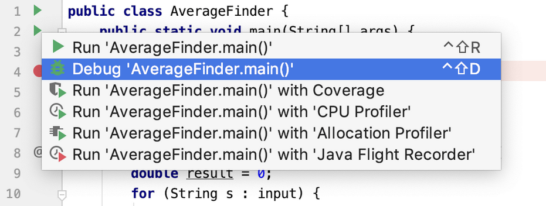
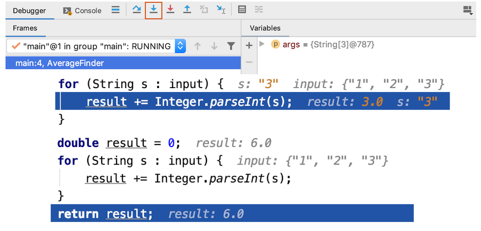

# Лекція 7: Пошук та усунення несправностей (Troubleshooting)

> **Декларація курсу.** Академічна доброчесність та авторство матеріалів — у [DISCLAIMER.md](DISCLAIMER.md).


## ⚡ Експрес-опитування: Активація знань

Ми щойно вивчили багатопотоковість. Давайте подумаємо, які проблеми це створює:

1.  У [Лекції 6](06_threads.md) ми бачили приклад "Deadlock". Уявіть, що ваша програма "зависла". Як ви думаєте, як виглядає це "зависання" для JVM?
2.  Ви запустили симулятор "Банки" з [Практикуму 7](p07_race_condition.md) з 50 000 потоків. Програма впала. Яку помилку ви очікуєте побачити? (Підказка: це `Error`).
3.  Ваш додаток раптом почав сильно "гальмувати". Як ви думаєте, що може бути причиною з точки зору управління пам'яттю?

<details markdown="1">
<summary>Наші очікування (відповідь)</summary>

1.  Для JVM потоки не "зависли", вони перебувають у стані **`BLOCKED`**. Вони коректно чекають на монітор (замок), який ніколи не буде звільнено. Ми маємо навчитися "зазирати" всередину JVM, щоб побачити це.
2.  Створення 50 000 потоків (кожен з яких вимагає пам'яті під свій стек) найімовірніше призведе до **`OutOfMemoryError`**. Це критична помилка JVM.
3.  Найімовірніша причина — **Garbage Collector (GC)**. Якщо програма створює занадто багато "сміття" (короткоживучих об'єктів), GC може почати працювати безперервно, "зупиняючи світ" (Stop-the-World), щоб очистити пам'ять, що і викликає "гальмування".

</details>

## Вступ: У розробці немає магії, є лише інтерпретація

Привіт усім\! У розробці немає ніякої "магії" — є лише **розуміння системи та коректна інтерпретація її поведінки**. Програмування за своєю природою схоже на **доведення математичної теореми**: кожен збій, "зависання" чи дивний результат має строгий причинно-наслідковий ланцюжок. Це просто симптоми, які потрібно вміти правильно прочитати.

У реальній інженерній практиці робочий час розробника розподіляється приблизно так:

* **20–30%** — написання нового коду;
* **~50%** — читання, аналіз та осмислення існуючого (часто чужого) коду;
* **~20%** — пошук та усунення несправностей (**troubleshooting & debugging**).

### Парадокс якісного дизайну

Згадаймо попередні теми: [принципи SOLID](05_solid.md), поліморфізм, інтерфейси, Generics та [багатопотоковість](06_threads.md). Ми спеціально проєктуємо систему так, щоб розбити велику задачу на десятки маленьких незалежних класів і паралельних потоків.

Але тут виникає **інженерний парадокс**: чим гнучкішою, модульнішою та багатопотоковішою стає архітектура, тим легше її розширювати — і водночас тим важче знайти в ній дефект "просто переглядаючи код очима". Коли один запит проходить крізь ланцюжок інтерфейсів і обробляється різними потоками, одного лише читання вихідного коду недостатньо.

Найкращий спосіб боротьби з помилками — поєднувати правильний дизайн коду з професійними інструментами спостереження за JVM. В основі такого дизайну лежить **Розмежування повноважень (Separation of Concerns, SoC)**.

### Що таке Розмежування повноважень?

Це загальна концепція, яка дозволяє розділити складність однієї великої проблеми на легші для вирішення підпроблеми. Вперше цю ідею сформулював Едсгер Дейкстра. На практиці цей принцип відповідає пошуку правильної **декомпозиції** або **модуляризації** проблеми.

Протягом багатьох років це призвело до появи таких підходів, як об'єктно-орієнтоване програмування (про яке ми говорили в лекції про SOLID).

Останнім часом цей принцип застосовують для розділення **функціональних** (що програма робить) та **нефункціональних** (як вона це робить) вимог. Прикладами нефункціональних вимог є логування, безпека, відмовостійкість.

Такі "наскрізні" (cross-cutting) проблеми важко виділити в окремі модулі. Код, що відповідає за логування, наприклад, не знаходиться в одному класі, а "пронизує" десятки класів і методів. Коли цей принцип порушено, код стає "магічним" у поганому сенсі: незрозумілим, заплутаним, і пошук помилок у ньому перетворюється на пекло.

Одним з рішень цієї проблеми є **Аспектно-орієнтоване програмування (AOP)**, яке дозволяє виносити таку наскрізну логіку в окремі модулі (аспекти).

Але що робити, коли помилки вже трапились? Сьогодні ми розглянемо основні методи та інструменти, щоб "декодувати" симптоми і знайти причину.

-----

## Перш ніж почати: Карта JVM



Щоб шукати проблеми, треба знати, *де* шукати. Більшість проблем у Java-додатку трапляються в одному з компонентів віртуальної машини Java (JVM).

Ось головні області, за якими ми будемо "полювати":

1.  **Class Loader Subsystem (Завантажувач класів):** Відповідає за завантаження ваших `.class` файлів (байткоду) в пам'ять.
2.  **Runtime Data Area (Область даних часу виконання):**
      * **Heap (Купа):** Головна "проблемна" зона. Тут живуть *усі* ваші об'єкти. Якщо вона переповнюється, ви отримуєте `OutOfMemoryError` .
      * **Stack (Стек):** Створюється для *кожного* потоку. Тут живуть локальні змінні та посилання на об'єкти в купі. Якщо стек переповнюється (наприклад, через нескінченну рекурсію), ви отримуєте `StackOverflowError` .
      * **Method Area:** Зберігає метадані про ваші класи.
3.  **Execution Engine (Механізм виконання):**
      * **JIT Compiler (JIT-компілятор):** Перетворює байткод на швидкий машинний код .
      * **Garbage Collector (GC, Збирач сміття):** "Прибиральник", який чистить купу (Heap) від об'єктів, що більше не використовуються.

-----

## Інструмент 1: "Моделювання в голові" (Аналіз Stack Trace)

Це ваш основний інструмент. Коли програма "падає" з винятком (Exception), вона виводить **Stack Trace** — "звіт про те, що трапилось".

### Чому Stack Trace виглядає "перевернутим"? (Принцип LIFO)

Як ми пам'ятаємо з [Лекції 4](04_java_exceptions.md), кожен потік зберігає послідовність активних викликів методів у **стеку викликів (Call Stack)**. Стек працює за принципом **LIFO (*Last In, First Out* — "останнім прийшов — першим вийшов")**: уявіть високу склянку, куди кожен новий виклик методу кладе фрейм **зверху**, а повернення з методу знімає верхній фрейм.

Коли стається виняток, термінал фізично друкує рядки зверху вниз, виймаючи фрейми з вершини цієї "склянки": від **найостаннішого методу**, де безпосередньо впала помилка, до **найпершого методу**, з якого починався ланцюжок викликів.

Давайте розберемо цей приклад і перевіримо себе на типовій пастці:

```
ERROR main c.z.h.p.HikariPool HikariPool-1 Exception during pool initialization.
org.postgresql.util.PSQLException: The connection attempt failed.
	at org.postgresql.core.v3.ConnectionFactoryImpl.openConnectionImpl(ConnectionFactoryImpl.java:292)
	at org.postgresql.core.ConnectionFactory.openConnection(ConnectionFactory.java:49)
	at org.postgresql.jdbc.PgConnection.<init>(PgConnection.java:195)
	at org.postgresql.Driver.makeConnection(Driver.java:458)
	at org.postgresql.Driver.connect(Driver.java:260)
	at com.zaxxer.hikari.util.DriverDataSource.getConnection(DriverDataSource.java:136)
	at com.zaxxer.hikari.pool.PoolBase.newConnection(PoolBase.java:369)
	at com.zaxxer.hikari.pool.PoolBase.newPoolEntry(PoolBase.java:198)
	at com.zaxxer.hikari.pool.HikariPool.createPoolEntry(HikariPool.java:467)
	at com.zaxxer.hikari.pool.HikariPool.checkFailFast(HikariPool.java:541)
	at com.zaxxer.hikari.pool.HikariPool.<init>(HikariPool.java:115)
	at com.zaxxer.hikari.HikariDataSource.<init>(HikariDataSource.java:81)
```

**⚡ Міні-бліц (два питання з підступом):**
1. Який метод у цьому фрагменті викликався хронологічно **найпершим**?
2. У якому саме класі та рядку **безпосередньо сталася помилка**?

<details markdown="1">
<summary>Перевірте себе (як читати Stack Trace)</summary>

Новачки часто плутають ці два напрямки! Хронологію викликів читаємо **знизу вгору**, а місце аварії дивимось **на самій вершині**:

1.  **Найперший виклик (дно стека, внизу):** все почалося в конструкторі `HikariDataSource.<init>` (рядок `81`).
2.  Він викликав конструктор `HikariPool.<init>` (рядок `115`), той — `checkFailFast` (рядок `541`), і так далі вгору по стеку...
3.  **Точка падіння (вершина стека, нагорі):** помилка сталася безпосередньо у методі `ConnectionFactoryImpl.openConnectionImpl` (рядок `292`).
4.  **Що саме сталося (Тип + Повідомлення):** `PSQLException: The connection attempt failed` (не вдалося підключитися до бази даних PostgreSQL).

**Висновок:** Програма не запустилася, бо пул з'єднань HikariCP не зміг відкрити мережеве підключення до PostgreSQL.

</details>

### Як читати вкладені винятки (`Caused by`)

У реальних багатошарових системах низькорівневий виняток часто перехоплюють і "загортають" у високорівневий бізнес-виняток (`throw new RuntimeException("Не вдалося запустити сервіс замовлень", e)`). Тоді звіт складається з кількох каскадів:

```
java.lang.RuntimeException: Не вдалося запустити сервіс замовлень
	at org.example.TroubleshootingSample.initializeOrderModule(TroubleshootingSample.java:50)
	at org.example.TroubleshootingSample.printSampleChainedStackTrace(TroubleshootingSample.java:40)
	at org.example.TroubleshootingSample.main(TroubleshootingSample.java:24)
Caused by: java.lang.IllegalStateException: Connection refused: БД недоступна за адресою jdbc:postgresql://localhost:5432/orders
	at org.example.TroubleshootingSample.openTcpSocket(TroubleshootingSample.java:59)
	at org.example.TroubleshootingSample.connectToDatabase(TroubleshootingSample.java:55)
	at org.example.TroubleshootingSample.initializeOrderModule(TroubleshootingSample.java:48)
	... 2 more
```

> **Золоте правило `Caused by`:** Верхній виняток показує лише *наслідок* для бізнес-логіки. Щоб знайти **першопричину (root cause)**, гортайте лог до **найостаннішого блоку `Caused by:`** у самому низу звіту — і вже в ньому дивіться на **перший рядок `at ...`** (`openTcpSocket:59`).

-----

## Інструмент 2: Логування (Application Logging)

`System.out.println` — це не логування. У реальних проєктах використовуються спеціальні бібліотеки.

  * **Facade (Фасад):** **SLF4J**. Ваш код має залежати *тільки* від нього. Це просто "адаптер", який дозволяє підключити будь-який фреймворк логування.
  * **Framework (Фреймворк):** **Logback** або **Log4j**. Це реальні бібліотеки, які виконують роботу (пишуть у файл, ротують логи тощо) .

### Рівні, Апендери та Шаблони

  * **Рівні (Levels):** Дозволяють фільтрувати повідомлення за важливістю (TRACE, DEBUG, INFO, WARN, ERROR, FATAL).
  * **Апендер (Appender):** Визначає, *куди* писати лог (у консоль, у файл, в базу даних).
  * **Шаблон (Layout):** Визначає, *як* виглядає повідомлення (наприклад, `[2025-11-04] [ERROR] [main] ...`).
  * **MDC/NDC:** Дозволяє додавати до логів контекст (наприклад, `requestId`), щоб відстежити повний шлях запиту через різні сервіси.

### Стилі логування

  * **ПОГАНО (Конкатенація `+`):** `LOG.debug("Notifications: " + notifications);` 
      * **Чому?** Рядок `"Notifications: " + notifications` буде створено *завжди*, навіть якщо рівень логування `INFO` і цей `DEBUG` нікому не потрібен. Це марна трата пам'яті.
  * **ДОБРЕ (Плейсхолдери `{}`):** `LOG.debug("Notifications: {}", notifications);` 
      * **Чому?** Рядок буде відформатовано, *тільки якщо* рівень логування `DEBUG` увімкнено.
  * **НАДТО ДЕТАЛЬНО (Обгортка `if`):** `if (LOG.isDebugEnabled()) { ... }` 
      * **Чому?** Це вирішує проблему конкатенації, але робить код громіздким. Плейсхолдери `{}` роблять те саме автоматично.

### Золоті правила логування 

**1. Логуйте примітиви, а не об'єкти** 

  * **ПОГАНО:** `LOG.debug("salesOrderNotification: {}", salesOrderNotification);` 
      * **Чому?** Викликається `salesOrderNotification.toString()`. Цей метод може бути повільним, "завалити" лог тисячами рядків, або навіть викликати рекурсію і `StackOverflowError`.
  * **ДОБРЕ:** `LOG.debug("SalesOrderName: {}", salesOrderName);` (String — це окей) 
  * **ДОБРЕ:** `LOG.debug("locationsAmount: {}", locations.size());` (Примітиви — ідеально) 

**2. Використовуйте плейсхолдери `{}` (як зазначено вище)**

Логування — це настільки важливий інструмент, що ми присвятили йому цілу окрему лекцію, де детально розбираємо сучасний стек SLF4J + Logback: [Лекція 8: "Чорна скринька" вашого додатку. Вступ до логування](08_logging.md)

**3. Обережно з примітивами (Autoboxing)**

Хоча використання `{}` — це стандарт, воно має приховану ціну.
Коли ви пишете `LOG.debug("Count: {}", 5);`, число `5` (примітив `int`) перетворюється на об'єкт `Integer`. Цей процес називається **Autoboxing**.
Це створює зайвий об'єкт у пам'яті (сміття для GC). У високонавантажених циклах це може стати проблемою. Тому для примітивів у критичних місцях краще використовувати перевірку:
`if (LOG.isDebugEnabled()) { ... }`

-----

## Інструменти 3 та 4: Аналіз пам'яті (GC Logs, Heap Dumps)

### OOM — це не збій, а проблема дизайну

**Проблема:** `OutOfMemoryError` (OOM).
**Важливо:** OOM — це не випадковий збій, це **функціональна проблема**. В 99% випадків це означає помилку у вашому дизайні або коді (наприклад, "витік пам'яті" — memory leak).

Щоб керувати розміром купи (Heap), використовуються два основні прапорці JVM:

  * `-Xms<Size>` (наприклад, `-Xms2G`): Встановлює **початковий** (і мінімальний) розмір купи.
  * `-Xmx<Size>` (наприклад, `-Xmx8G`): Встановлює **максимальний** розмір купи.

### Коротко про пам'ять (Heap)

Купа ділиться на покоління:

  * **Young Generation (Молоде покоління):** Тут об'єкти народжуються (в області **Eden**). Ті, що виживають після "малого" GC, переїжджають у **Survivor Space** (S0, S1) .
  * **Old Generation (Старе покоління):** Сюди переїжджають об'єкти, що "довго живуть". Очищується під час "великого" (`Full GC`).
  * **Metaspace:** (З Java 8) Замінив старий PermGen, тут зберігаються метадані класів .

### Приховані пастки пам'яті в продакшені

Навіть якщо в додатку немає класичного витоку пам'яті (`memory leak`) і `OutOfMemoryError` не виникає, неефективна робота з купою здатна різко сповільнити сервіс:

1.  **Надвисока швидкість алокації (High Allocation Rate):** Сервіс може утримувати в моменті всього 200 МБ "живих" даних, але генерувати тимчасове сміття у `Young Generation` зі швидкістю **1 ГБ/с** — наприклад, через конкатенацію рядків у циклах або масове створення важких структур на кшталт `HashMap` заради кількох елементів (де масив бакетів та об'єкти-вузли `Node` займають у рази більше пам'яті, ніж самі корисні дані). У результаті GC працює безперервно й відбирає процесорний час у бізнес-логіки.
2.  **Гігантські об'єкти (Humongous Objects):** Дуже великі масиви чи рядки (у збирачі G1 — об'єкти розміром ≥ 50% регіону купи, зазвичай від ~1 МБ і більше) не поміщаються в `Eden`/`Survivor` і виділяються **одразу в `Old Generation`**, швидко провокуючи дорогі збірки `Full GC`.

### Типи посилань (Reference Types)

Збирач сміття (GC) видаляє об'єкти, на які немає посилань. Але посилання бувають різними:

  * **Strong (Сильні):** Звичайне посилання (`MyObject obj = new MyObject()`). Поки воно існує, GC не видалить об'єкт.
  * **Soft (М'які):** Використовуються для кешів. GC видалить такий об'єкт, *тільки* якщо пам'ять закінчується, але до OOM.
  * **Weak (Слабкі):** GC видалить такий об'єкт при наступній збірці сміття, як тільки зникнуть сильні посилання.
  * **Phantom (Фантомні):** Використовуються, щоб дізнатися, коли об'єкт *точно* був видалений.

### Інструменти для аналізу:

1.  **GC Log та `GCViewer`:** Це текстовий журнал роботи збирача сміття, який зручно візуалізувати у програмі **GCViewer**.

    

    На графіку та бічній панелі **Summary** варто звертати увагу на чотири речі:
      * **"Пилка" використання купи (Used Heap, синя лінія):** плавний ріст під час створення об'єктів і різке падіння після малого GC — це нормальне "дихання" здорового додатку (нижній графік на скріншоті, де після кожної збірки пам'ять падає майже до базового рівня, а `Throughput` становить `99.95%`). Якщо ж нижня межа "пилки" після кожного GC повзе вгору, змушуючи JVM ступінчасто розширювати купу (верхній графік на скріншоті) — це класичний симптом витоку пам'яті (`memory leak`) або накопичення довгоживучих кешів.
      * **Паузи збірки сміття та лінії `Full GC` (Stop-the-World):** важкі паузи (наприклад, `Max Pause: 0.29116s` — майже 300 мс у верхньому вікні), під час яких **усі робочі потоки додатку повністю завмирають**. У реальному житті це схоже на прибирання кімнати: поки прибиральник миє підлогу, вас виганяють у коридор і робота зупиняється. Часті або тривалі паузи означають деградацію часу відповіді сервісу.
      * **Верхня планка зарезервованої пам'яті (Committed Heap / Footprint):** зафарбовані області показують обсяг пам'яті, який JVM вже забрала у операційної системи (`Footprint: 22,528K`). Навіть коли живих об'єктів стало мало, JVM часто не поспішає повертати виділену RAM операційній системі "про запас". На локальному ноутбуці це майже непомітно, але в хмарних середовищах (AWS, GCP, Azure, Kubernetes) ви платите гроші саме за утримувану контейнером пам'ять.
      * **Ключові метрики на вкладці `Summary`:**
          * **`Throughput` (Пропускна здатність, `%`):** частка часу, коли додаток виконував корисну бізнес-роботу, а не стояв у паузах GC (`99.95%` при сумарних паузах `Acc pauses: 0.21s` за `Total Time: 427.78s` — здоровий показник).
          * **`Freed Memory` та `Freed Mem/Min`:** скільки сумарно сміття очистив GC (`38,126K`, тобто більше за весь розмір купи `22,528K`) і з якою швидкістю додаток генерує та утилізує об'єкти (`5,348K/min`).
2.  **Heap Dump (Дамп купи):** Операційна система суворо ізолює віртуальну пам'ять процесів і припинить будь-яку зовнішню спробу прочитати чужу RAM. Проте сама JVM створена з розрахунком на діагностику і дозволяє зробити повну "фотографію" всієї купи у бінарний файл `.hprof` (вручну або автоматично при OOM за допомогою прапорця `-XX:+HeapDumpOnOutOfMemoryError`).
      * **Як отримати:** `jcmd <pid> GC.heap_dump <filename>.hprof` або `jmap`.
      * **Аналіз:** Дамп відкривається в програмі **Eclipse MAT (Memory Analyzer Tool)**, яка показує, які саме колекції чи класи утримують найбільше пам'яті і *чому* GC не може їх видалити (підтримується мова запитів до об'єктів **OQL**).
      * **⚠️ Правило інформаційної безпеки:** **Ніколи не пересилайте "сирі" Heap Dump із продакшену у відкриті чати чи стороннім підрядникам!** Оскільки це побайтовий знімок оперативної пам'яті, у ньому у відкритому вигляді (`String`, `char[]`) можуть зберігатися паролі до баз даних, ключі шифрування, токени сесій та персональні дані клієнтів.

-----

## Інструмент 5: Java Flight Recorder (JFR)

Це "швейцарський ніж" для діагностики. Це вбудований у JVM профіль, який збирає дані про *все* з мінімальними накладними витратами.





JFR використовується разом з **JDK Mission Control (JMC)** і дозволяє аналізувати:

  * Використання пам'яті та цикли GC.
  * Стани потоків та блокування.
  * Операції вводу-виводу (Файли, Сокети) .
  * Винятки, що найчастіше трапляються.

-----

## Інструмент 6: Thread Dump (Дамп потоків)

**Що це?** Миттєвий знімок стану *всіх* потоків у JVM (кожен потік + його поточний стан + власний Stack Trace).
**Коли?** Коли програма "зависла", не відповідає на запити або аномально навантажує CPU.
**Як створити?**

  * **Універсально і рекомендовано (JDK):** `jstack <pid>` або `jcmd <pid> Thread.print` (результат зручно одразу перенаправити у файл: `jstack <pid> > dump.txt`).
  * **Linux/macOS:** `kill -3 <pid>` — команда абсолютно безпечна (надсилає сигнал `SIGQUIT`, а **не** вбиває процес!), але друкує дамп у стандартний потік виводу (`stdout`) самого додатку. Якщо сервіс працює у фоні без доступу до консолі, ви не побачите вивід у поточному терміналі, тому використовуйте `jstack`.
  * **Windows:** `Ctrl + Break` у вікні консолі, де запущено процес.

### Як дізнатися PID процесу?

Перш ніж знімати дамп, потрібно дізнатися ідентифікатор процесу (`PID`) в операційній системі:

1.  **Штатні утиліти JDK (починайте саме з них):**
      * **`jcmd`** або **`jps -l`** — найнадійніший спосіб для розробника: напряму опитує всі запущені віртуальні машини Java на комп'ютері та виводить їхній `PID` і повне ім'я класу з `main`. Це працює навіть тоді, коли JVM-додаток запущено через нативний виконуваний лаунчер (наприклад, процес самої IntelliJ IDEA має ім'я `idea` і не знайдеться простим пошуком слова `java` у списку процесів ОС).
2.  **Системні команди ОС (резервний варіант на серверах, де встановлено лише урізаний JRE без `jcmd`/`jps`):**
      * **`ps -ef | grep java`** або **`ps -faux | grep java`** — знайти процеси та дерево їх запуску (Linux/macOS).
      * **`ss -tulpn | grep <port>`** (або `netstat -nlp | grep <port>`) — знайти `PID` процесу, який слухає конкретний мережевий порт (наприклад, `8080`).

### Як читати Thread Dump (Структура)

Ось типовий заголовок :

```
2020-07-18 09:55:42
Full thread dump OpenJDK 64-Bit Server VM (13.0.2+8 mixed mode, sharing):

"main" #1 prio=5 os_prio=31 cpu=103.5 elapsed=19.55s tid=0x00007fb2b0008800 nid=0x2803 waiting on condition [0x0000700004e2e000]
   java.lang.Thread.State: TIMED_WAITING (sleeping)
	at java.lang.Thread.sleep(java.base@13.0.2/Native Method)
	at com.pv.drafts.threaddump.simple.SingleMainThreadProgram.main(SingleMainThreadProgram.java:5)
```

Що ми тут бачимо:

  * **"main"**: Ім'я потоку.
  * **`#1`**: ID потоку.
  * **`prio=5`**: Пріоритет Java.
  * **`tid=...`**: Адреса в пам'яті JVM.
  * **`nid=0x2803`**: **Native ID**. Це ID потоку на рівні операційної системи. (Дуже важливо\!)
  * **`java.lang.Thread.State: TIMED_WAITING (sleeping)`**: Стан потоку.
  * `at ...`: Стек викликів (Stack Trace) цього потоку.

### Аналіз станів потоків (Приклади)

**1. Приклад: `BLOCKED (on object monitor)`** 

```
"blocked-thread" #23 ... waiting for monitor entry [0x0000700002659000]
   java.lang.Thread.State: BLOCKED (on object monitor)
	at com.pv.drafts.threaddump.blocked.BlockedThreadProgram$SyncRunnable.run(BlockedThreadProgram.java:30)
	- waiting to lock <0x000000070fe85508> (a java.lang.Object)
...
"blocking-thread" #21 ...
   java.lang.Thread.State: TIMED_WAITING (sleeping)
	at java.lang.Thread.sleep(java.base@13.0.2/Native Method)
	at com.pv.drafts.threaddump.blocked.BlockedThreadProgram$SyncRunnable.run(BlockedThreadProgram.java:31)
	- locked <0x000000070fe85508> (a java.lang.Object)
```

  * **Інтерпретація:** Потік `#23` (`blocked-thread`) у стані `BLOCKED`, бо він `waiting to lock <...5508>`. Потік `#21` (`blocking-thread`) у стані `TIMED_WAITING`, але він утримує той самий монітор: `locked <...5508>`.
  * **Висновок (⚠️ не плутайте з Deadlock!):** Потік `#21` викликав `Thread.sleep()` *усередині* секції `synchronized` (той самий антипатерн, про який ми попереджали у [Лекції 6](06_threads.md)!) і тримає замок, поки спить. Це **"вузьке місце" (lock contention)**, але ще **не** дедлок: щойно потік `#21` прокинеться і вийде з блоку, потік `#23` продовжить роботу. Справжнє взаємне блокування — у наступному прикладі.

**2. Приклад: `DEADLOCK`** 

```
Found one Java-level deadlock:
=============================
"Thread-0":
  waiting to lock monitor ... (object 0x...65f8),
  which is held by "Thread-1"
"Thread-1":
  waiting to lock monitor ... (object 0x...65b0),
  which is held by "Thread-0"
```

  * **Інтерпретація:** `jstack` одразу каже нам про дедлок. Потік-0 чекає на замок, який тримає Потік-1. А Потік-1 чекає на замок, який тримає Потік-0 . Вони ніколи не продовжать роботу.

**3. Приклад: `RUNNABLE` (Високе навантаження CPU)** 
Ви помітили в `top`, що процес (PID `12897`) вантажить CPU .

1.  Запускаєте `top -H -p <pid>`, щоб побачити потоки:
    ```
    PID   USER    ... %CPU  ... COMMAND
    12897 pv      ... 87.3  ... HIGH
    12898 pv      ...  4.5  ... MEDIUM
    ```
    
2.  Берете "проблемний" PID потоку: `12897`.
3.  Переведіть його в шістнадцяткове значення (HEX): `12897` -> `0x3261`. Це `nid` *(примітка: у Java 21+ `jstack` додатково показує і десятковий системний ID потоку у квадратних дужках поруч із номером потоку, що ще більше спрощує пошук)*.
4.  Шукаєте `nid=0x3261` у вашому Thread Dump:
    ```
    "HIGH" #12 ... nid=0x3261 runnable [0x00007f7ee61b5000]
       java.lang.Thread.State: RUNNABLE
    	at com.pv.drafts.threaddump.RunningTread.run(HighCpuThreadProgram.java:48)
    ```
    

<!-- end list -->

  * **Інтерпретація:** Ми знайшли\! Потік "HIGH" знаходиться у стані `RUNNABLE` (тобто працює) і "крутиться" у методі `run` в файлі `HighCpuThreadProgram.java` на рядку 48 . Ймовірно, там нескінченний цикл.

### Швидкі поради (Tips & Tricks)

  * **Підрахувати потоки:** `ps -o nlwp <pid>` (покаже загальну кількість потоків процесу) .
  * **Сортувати за станом (Linux):** `grep 'java.lang.Thread.State' dump.txt | sort | uniq -c | sort -n` (покаже, скільки потоків в `RUNNABLE`, `BLOCKED` тощо) .

**Можливі причини проблем:**

  * **Висока затримка (High latency):**
      * Занадто багато потоків.
      * Потоки масово заблоковані на одній `synchronized` секції.
  * **Періодична логіка не працює:**
      * Потік, що відповідав за цю логіку, завершив роботу (наприклад, через виняток).
  * **Високе навантаження CPU:**
      * Потік у стані `RUNNABLE` з нескінченним циклом.
      * "Поганий" код (неефективні алгоритми).

### Практика наживо: знімаємо власний Thread Dump

Ви можете перевірити обидва сценарії за 30 секунд на навчальному стенді `TroubleshootingSample` у модулі `thread-samples`:

1. Запустіть клас `org.example.TroubleshootingSample` в IDE — він виведе у консоль власний `PID` та створить чотири іменовані потоки (`"blocking-holder"`, `"blocked-waiter"`, `"deadlock-A"`, `"deadlock-B"`).
2. Відкрийте термінал, переконайтеся, що `jcmd` бачить ваш процес, і зніміть дамп:
   ```bash
   jcmd
   jstack <PID>
   ```
3. Знайдіть у виводі різницю між тимчасовим очікуванням монітора (`"blocked-waiter"` чекає на сплячий `"blocking-holder"`) та фінальною секцією `Found one Java-level deadlock:` для пари `"deadlock-A"` і `"deadlock-B"`. Зверніть увагу, наскільки осмислені імена потоків полегшують діагностику порівняно зі стандартними `"Thread-0"`, `"Thread-1"`!

-----

## Інструмент 7: Live Debugging (JDWP та IDE)

Це те, що ви робите щодня у вашій IDE. Ви підключаєтесь до JVM "наживо" через протокол JDWP (Java Debug Wire Protocol).



Процес простий:

1.  **Set Breakpoint (Точка зупину):** Ви кажете IDE: "Зупини виконання програми тут".
2.  **Run Debug Mode:** Запускаєте програму в режимі відладки.
3.  **Step Thru (Покрокове виконання):** Ви рухаєтесь по коду рядок за рядком, спостерігаючи за станом усіх змінних .





### Практикум в IDE: відладка багатопотоковості на прикладі "Обід філософів"

Спробуємо зазирнути всередину паралельної програми, яку ми запускали на [Лекції 6](06_threads.md) (`org.example.PhilosopherDining` та `Philosopher` у модулі `thread-samples`):

1.  **Поставте дві точки зупину (Breakpoints):** першу — у `PhilosopherDining.main()` на створенні `new Semaphore(2, true)`, другу — у класі `Philosopher` всередині методу `run()` безпосередньо на рядку `sem.acquire();`.
2.  **Запустіть `PhilosopherDining` у режимі Debug:** IDE запустить JVM з агентом JDWP і зупиниться у потоці `main`. Натисніть **Resume Program (`F9`)**, щоб потоки філософів стартували.
3.  **Перемикайтеся між потоками:** у лівій панелі **Frames / Threads** ви побачите живі іменовані потоки `"Socrates"`, `"Plato"`, `"Aristotle"`, `"Thales"`, `"Pythagoras"`. Обираючи будь-який потік зі списку, ви миттєво бачите його власний стек викликів і локальні змінні (`name`, `full = false`).
4.  **Спостерігайте за станом синхронізатора:** розгорніть об'єкт `sem` (`Semaphore`) у вкладці **Variables** і прокрокуйте кілька разів через **Step Over (`F8`)**. Ви наочно побачите, як внутрішній лічильник дозволів `permits` зменшується (`2` → `1` → `0`), після чого третій філософ блокується на `sem.acquire()`, доки хтось із перших двох не викличе `sem.release()`.

-----

## ✅ Контрольні питання

1.  **SoC:** Як принцип "Розмежування повноважень" пов'язаний з "Аспектно-орієнтованим програмуванням"? Наведіть приклад наскрізної проблеми.
2.  **JVM:** У чому ключова різниця між Heap (Купою) та Stack (Стеком)? Де живуть об'єкти, а де — посилання на них?
3.  **Stack Trace:** Чому Stack Trace виводиться "знизу вгору" відносно хронології викликів? Де шукати точне місце помилки у звичайному Stack Trace і де — якщо у звіті є кілька секцій `Caused by:`?
4.  **Logging:** Чому `LOG.debug("User data: {}", user)` вважається гіршою практикою, ніж `LOG.debug("User ID: {}", user.getId())`?
5.  **Logging Styles:** Чому використання `+` для конкатенації в логах (`LOG.debug("Data: " + data)`) є неефективним?
6.  **Memory & Security:** Що означає `OutOfMemoryError`, який інструмент (`.hprof` файл) і прапорець JVM використовують для роботи з купою, та чому не можна публікувати "сирі" Heap Dump із продакшену?
7.  **Threads:** Як дізнатися `PID` запущеної JVM за допомогою штатних утиліт JDK і як пов'язати потік, що споживає 100% CPU у `top -H`, із конкретним записом у Thread Dump?
8.  **Threads:** Ви зробили Thread Dump і бачите потоки у стані `BLOCKED (on object monitor)`. Чим тимчасове "вузьке місце" (lock contention) відрізняється у дампі від справжнього `DEADLOCK`?
9.  **JFR:** Як називається інструмент, що є "швейцарським ножем" для профілювання JVM, та програма для його аналізу?

<details markdown="1">
<summary>Відповіді (спробуйте спочатку відповісти самі)</summary>

1.  **SoC та AOP:** Принцип "Розмежування повноважень" (SoC) — це ідея розділення програми на окремі частини, кожна з яких вирішує одну проблему. Однак деякі проблеми (наприклад, логування, безпека, транзакції) є "наскрізними" і їхній код "пронизує" багато модулів. "Аспектно-орієнтоване програмування" (AOP) — це техніка, яка дозволяє реалізувати SoC для цих наскрізних проблем, виділяючи їх в окремі "аспекти".

2.  **Heap vs Stack:**

      * **Стек (Stack):** Приватний для кожного потоку (структура LIFO). Зберігає локальні змінні примітивних типів та **посилання** на об'єкти. Життєвий цикл змінної прив'язаний до життєвого циклу методу.
      * **Купа (Heap):** Спільна для всіх потоків. Зберігає **самі об'єкти** та масиви. Пам'ять звільняється Збирачем сміття (GC).

3.  **Stack Trace та `Caused by`:** Стек викликів працює за принципом **LIFO** ("склянка"), а термінал друкує його зверху вниз — від вершини стека до дна. Тому **найперший виклик** у хронології знаходиться в самому низу, а **місце, де сталася помилка**, — у **найпершому рядку зверху** під назвою винятку. Якщо ж виняток загорнутий в інші винятки, потрібно спуститися до **найостаннішого блоку `Caused by:`** унизу звіту (це першопричина — *root cause*) і подивитися на перший рядок `at ...` одразу під ним.

4.  **Logging (Об'єкти vs Примітиви):** Виклик `LOG.debug("User data: {}", user)` змушує Java викликати метод `user.toString()`. Цей метод може бути повільним (наприклад, обходити глибоку ієрархію об'єктів чи форматувати сотні полів), може викликати рекурсію (`StackOverflowError`) або "заспамити" лог. Логування примітивів чи конкретних полів (`user.getId()`) є швидким, безпечним і передбачуваним.

5.  **Logging Styles:** Конкатенація (`"Data: " + data`) створює новий об'єкт `String` *завжди* до виклику методу логера, навіть якщо рівень `DEBUG` вимкнений. Це марна трата CPU та пам'яті (високий Allocation Rate). Плейсхолдери (`"Data: {}"`) форматують рядок *тільки* якщо відповідний рівень логування увімкнений.

6.  **Memory & Security:** `OutOfMemoryError` — це критична помилка `Error`, яка виникає, коли JVM не може виділити пам'ять у Купі (`Java heap space`) або операційна система не може створити новий нативний потік через вичерпання пам'яті під стеки (`unable to create native thread`, як при запуску 50 000 потоків). Максимальний розмір купи задається прапорцем **`-Xmx`** (напр., `-Xmx8G`), а для пошуку витоків знімають **Heap Dump** (`.hprof`) і відкривають його в **Eclipse MAT**. Передавати "сирі" дампи з продакшену небезпечно, оскільки у пам'яті у відкритому вигляді лежать паролі, ключі доступу, токени та конфіденційні дані користувачів.

7.  **Threads (PID та CPU):**

    1.  Знайдіть `PID` JVM-процесу за допомогою **`jcmd`** або **`jps -l`**.
    2.  Використайте `top -H -p <pid>`, щоб знайти системний ID конкретного потоку, який навантажує CPU.
    3.  Переведіть це десяткове число у шістнадцятковий (HEX) формат — це буде **`nid`** (Native ID).
    4.  Зніміть дамп (`jstack <pid>`) і знайдіть потік із відповідним `nid=0x...`. Його стан буде `RUNNABLE`, а стек вкаже точний рядок коду (наприклад, нескінченний цикл).

8.  **Threads (`BLOCKED` vs `DEADLOCK`):** Стан `BLOCKED (on object monitor)` означає, що потік чекає на вхід у `synchronized`-секцію. Якщо потік-власник замка просто довго виконує операцію або спить у `TIMED_WAITING` (наприклад, через `Thread.sleep()` всередині `synchronized`), це **вузьке місце (lock contention)** — система повільна, але рухається далі після звільнення замка. При **справжньому `DEADLOCK`** два (або більше) потоки взаємно утримують замки один одного й чекають назустріч вічно (`jstack` виводить окрему секцію `Found one Java-level deadlock`).

9.  **JFR:** Інструмент називається **Java Flight Recorder (JFR)**, а програма для його аналізу — **JDK Mission Control (JMC)**.

</details>

---

**[⬅️ Практикум 7: Банка Monobank](p07_race_condition.md)** | **[Практикум 8: Сила ExecutorService ➡️](p08_executors.md)** | **[Лекція 8: Вступ до логування ➡️](08_logging.md)**

**[Повернутися до головного меню курсу](index.md)**