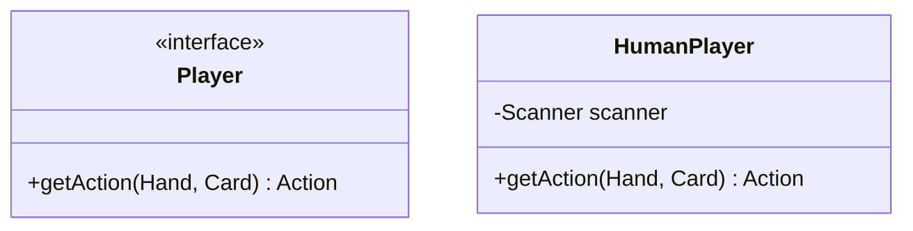
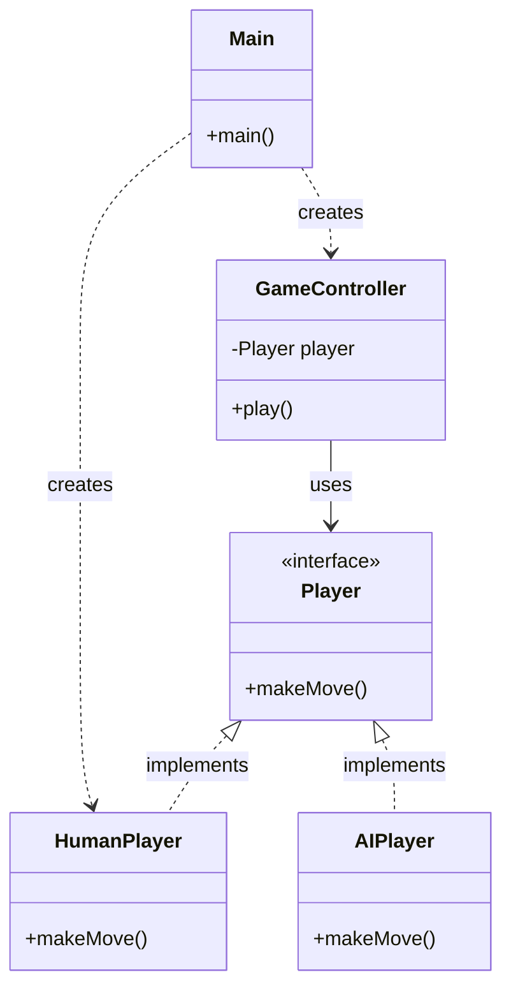

# Вказівка 4: Основи UML-діаграм класів для проєктування на Java

> **Декларація курсу.** Академічна доброчесність та авторство матеріалів - у [DISCLAIMER.md](DISCLAIMER.md).

**UML (Unified Modeling Language)** - це стандартна візуальна мова для опису структури та взаємодії програмних систем до того, як написано код.

У нашому курсі вам не потрібно знати всі 14 типів діаграм UML. Для проєктування модульної програми на Java достатньо **діаграми класів (Class Diagram)**. Вона показує:
1. Які класи та інтерфейси є у системі.
2. Які дані (поля) та поведінку (методи) вони мають.
3. Як вони залежать один від одного (де реалізовано DIP та SRP).

-----

## 1. Блок класу та інтерфейсу

Кожен клас або інтерфейс зображується у вигляді прямокутника з трьома секціями:

1. **Назва** (верхня секція). Для інтерфейсу додається стереотип `<<interface>>`.
2. **Поля / Атрибути** (середня секція).
3. **Методи / Операції** (нижня секція).

**Модифікатори доступу** позначаються символами перед назвою поля або методу:
* `+` - `public` (доступний ззовні; зазвичай це методи інтерфейсів та публічне API).
* `-` - `private` (прихований всередині класу; зазвичай це поля).
* `#` - `protected` (доступний у спадкоємцях).



-----

## 2. Основні типи зв'язків (стрілки)

Для опису більшості Java-проєктів вистачає чотирьох стрілок:

| Зв'язок | Синтаксис Mermaid | Що означає в Java | Приклад |
| :--- | :--- | :--- | :--- |
| **Реалізація** | `Interface <|.. Class` | `class HumanPlayer implements Player` (пунктир із порожнім трикутником до інтерфейсу) | `Player <|.. HumanPlayer` |
| **Наслідування** | `Parent <|-- Child` | `class Dog extends Animal` (суцільна лінія з порожнім трикутником до батька) | `Animal <|-- Dog` |
| **Асоціація (Використання)** | `A --> B` | Клас `A` зберігає посилання на `B` (поле) або постійно використовує його | `GameController --> Player` |
| **Залежність (Створення)** | `A ..> B` | Клас `A` тимчасово використовує або створює `B` (наприклад, `new` у `Main`) | `Main ..> Deck` |

**Як перевірити DIP на діаграмі:** подивіться, куди йдуть суцільні стрілки від вашого контролера (`GameController`). Якщо вони вказують на блоки з `<<interface>>`, а не на конкретні класи (`HumanPlayer`, `ConsoleGameDisplay`), принцип інверсії залежностей дотримано.

-----

## 3. Приклад діаграми

Нижче показано типовий фрагмент архітектури, де `Main` збирає залежності, а `GameController` працює лише через абстракції:



-----

## 4. Як додати діаграму у `readme.md`

Є два зручні способи:

1. **Текстом у Markdown через Mermaid (рекомендовано):** GitHub автоматично перетворює блоки ```` ```mermaid ```` на схему прямо у `readme.md`. Це зручно зберігати в Git, бо зміни видно у `git diff`.
2. **Зображенням:** намалювати діаграму в [draw.io](https://app.diagrams.net/) або PlantUML, зберегти як `.png`/`.svg` у репозиторій (наприклад, `docs/architecture.png`) і вставити через ``.

-----

**[Повернутися до фінального проєкту](n01_final_project.md)** | **[Головне меню курсу](index.md)**
